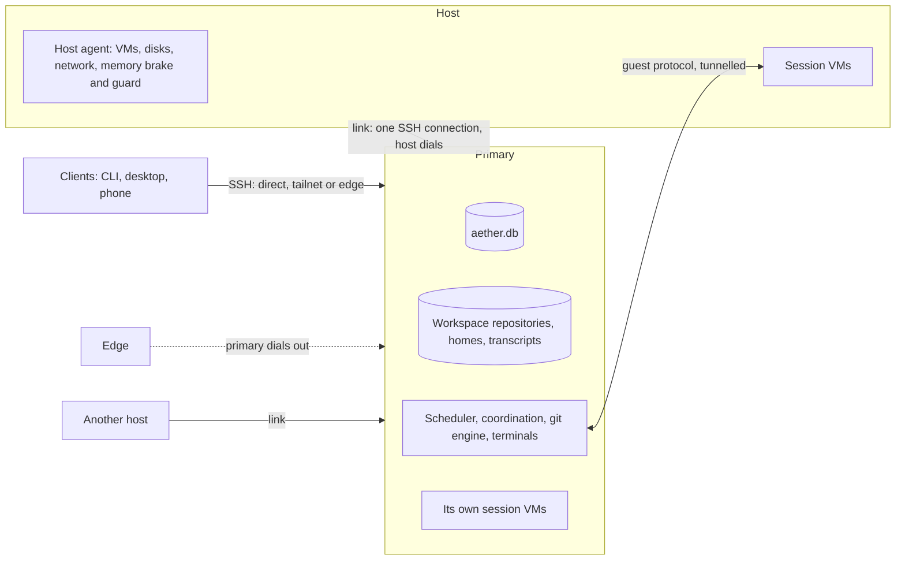
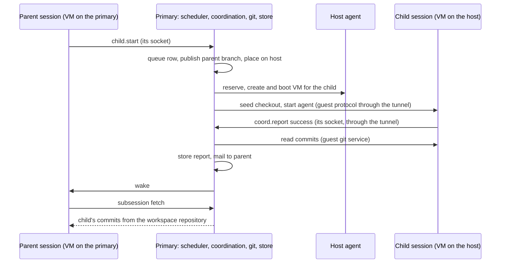

# Running Cloudfield on Several Machines

**Goal:** one person or team runs Cloudfield on several machines of their
own. When one machine is short of memory, a new session or sub-session
starts on another, and agents keep working together across machines.

**Status:** proposed 2026-11-27. Research and a plan; nothing is built. The
owner asked for it on 2026-11-26: "allowing for people to have multiple
machines they can run Cloudfield on, so that if one machine gets congested
or is almost full with RAM or whatever, another machine can pick up the
slack." [Decisions for the owner](#decisions-for-the-owner) lists what only
he can settle. [Review](#review) lists what review changed.

Evidence is in
[`research/2026-11-27-multi-machine/`](../../research/2026-11-27-multi-machine/README.md).
`E1` to `E7` below name its files `evidence/01-…` to `evidence/07-…`; each
claim there carries a file and line of this repository, or the URL that
was read.

## Recommendation

1. Keep one server as the **primary**. It keeps everything it has today:
   the database, members, mail between sessions, git, the dashboard, and
   the scheduler that supervises every session.
2. Other machines join as **hosts**. A host runs session VMs and nothing
   else: Cloud Hypervisor, the disks, the memory guard. It dials out to the
   primary, and the primary drives each VM through that link with the
   protocol it already speaks to a VM on its own disk.
3. A session is placed once, at launch, on the machine with the most room,
   and stays there. A launch that fits nowhere waits in a queue in the
   primary's database; it is not refused.
4. A host that loses its link freezes its VMs until the link is back. A
   session therefore never runs unsupervised and can never run twice.
5. No job queue product. Ship the single-machine half first (a waiting
   launch, a machine recorded on every session, a count of every refusal):
   it is useful alone and it measures whether a second machine is worth
   building.

## Terms

| Term | Meaning |
| --- | --- |
| Primary | The Cloudfield server as it is today, plus the list of hosts. One per installation |
| Host | A machine that runs session VMs for a primary. It has no database, members, dashboard or edge enrolment |
| Host agent | The program on a host: `cloudfield-server` started in a host role |
| Link | The one SSH connection a host keeps open to the primary. The host dials it |
| Placement | The primary's record of which machine a session's VM is on. Written once |
| Machine | The primary or a host, when the difference does not matter |

## Today

One process on one machine holds everything, and the code relies on that.

| What | How it is one machine | Source |
| --- | --- | --- |
| Database | One SQLite file, `aether.db`, with the event log in the same file. The event sequence counter is in memory | `internal/store/sqlite.go:35-60`, `internal/events/inproc.go:29-52` (E3 §1) |
| Sessions | The scheduler keeps one in-memory map of runs and one runtime built at start. `runs` has no host column | `internal/scheduler/scheduler.go:270`, `internal/server/server.go:328-369`, `internal/store/migrate.go:442-458` (E1 §0, §7) |
| Recovery | After a restart every active run in the database is recovered here; a run whose container or sidecar file is missing ends `interrupted` with `server restarted` | `internal/scheduler/recovery.go:689-725`, `1408-1412`, `1477-1479` (E1 §6 lists 20 such places) |
| Admission | Memory, disk and the server's own stall are measured on this machine; reservations are in memory | `internal/scheduler/capacity.go:32-45`, `309-387` (E1 §1) |
| A refused launch | Fails at once with `-32004`. A queued sub-session that capacity refuses becomes `refused` and is never retried | `internal/scheduler/capacity.go:197-211`, `internal/sshd/errors.go:105-108`, `internal/children/dispatch.go:63-73` (E1 §1) |
| Session identity for coordination | A Unix socket per session on the server's disk. "Nothing on the wire names a sender" | `internal/coord/socket.go:54-59`, `380-384` (E2 §1) |
| Wakes | Go calls from the coordination service into the scheduler, and Go channels | `internal/server/svc_coord.go:33-62`, `internal/coord/mailbox.go:1329-1383` (E2 §3) |
| Git | One bare repository per workspace on the server's disk | `internal/gitengine/engine.go:220-225` (E3 §2) |
| Agent logins | One copy of each login, in the member's home on the server | `docs/security.md:242-244`, `328-332` (E3 §4) |
| Saved VMs | Memory and disks under `<data-dir>/vm/<run id>/`; the saved state names its disks by absolute path; disks, checkouts and images hard-link each other | `internal/runtime/vm/save.go:333-335`, `406-437`, `docs/install.md:155-157` (E1 §3, §4) |
| Reaching the server | One SSH port carries git, control, terminals and events. Through an edge the server dials out | `docs/networking.md:3-7`, `docs/edge.md:18-31` (E3 §7, §8) |

One part of the code is already cut for a second machine: the session VM.
The server reaches a VM only through three gRPC services over the VM's
host socket: process and terminal (16 calls), git (13) and the home file
service (16) (`internal/guest/guestpb/guest.proto:10-41`,
`git.proto:10-52`, `home.proto:12-28`). The protocol is versioned
(`internal/guest/client.go:25-26`). Terminal output is read at a byte
offset the VM keeps, "so an attachment rides through a VM save and restore,
and a new server can attach where an old one left"
(`internal/guest/attach.go:13-15`). A git snapshot "counts as delivered only
once the server acknowledges it" (`docs/vm-guest.md:618-650`). The sockets a
session dials (coordination, signing) are forwarded per VM
(`internal/runtime/vm/share.go:22-60`). And the function that opens the
connection to a VM is a replaceable field
(`internal/runtime/vm/engine.go:83`). E7 §1.1 has the detail.

A client already keeps several named server links
(`internal/cli/config.go:19-100`) and one edge account can own several
servers (`internal/edge/store/edgestore.go:204-214`), so a person can run two
unrelated servers today and switch between them.

### The baseline is moving

Pull requests #1153 to #1172 change launch, wake and memory on one machine
(E1, opening section and §9). Merged: #1161, #1163, #1168. Open: #1154,
#1156, #1158, #1162, #1164, and the drafts #1159 (idle VMs paused in
memory, saved to disk only when memory is short or after an hour), #1160,
#1167 and #1172 (huge pages). This plan assumes they land:

- #1158 logs the time of each launch and wake step. The plan's
  measurements use that log.
- #1159 makes a sleeping session hold host memory until the guard saves
  it. A machine then looks fuller than its working sessions make it, and
  placement must count memory the guard can still free
  ([Placement](#2-placement)).
- #1164 moves the mirror fetch out of the server-wide launch lock
  (`internal/sshd/handlers.go:288`). Placement adds a call to another
  machine to a launch, and that call must stay outside the lock too. Today
  the lock is held across the capacity check
  (`internal/scheduler/launch.go:316-418`; E7 §3).

### What 2026-11-26 showed

The owner's brief for this plan records that the server ran out of memory
for seven hours on 2026-11-26: its memory guard evicted sessions, sleeping
sessions could not be woken or closed, and queued launches did not start.
No document, commit or pull request in the repository describes that day
(E1 §10), so the brief is the only source.

The code explains each symptom:

- The guard saves VMs to disk to free memory, and a wake must then pass
  admission for the size of the saved memory
  (`internal/scheduler/capacity.go:173-190`). On a full machine every wake
  is refused and the session stays asleep (`docs/failure-handling.md:809-812`).
- A close of a VM session boots the VM to commit its work when the VM is
  gone (`internal/scheduler/evidence.go:150-177`); that boot needs memory.
- A queued sub-session that capacity refuses is not retried
  (`internal/children/dispatch.go:63-73`).

What a second machine would have changed: new sessions and sub-sessions
would have started there. What it would not have changed: the sessions
asleep on the full machine, whose disks and saved memory are on that
machine ([Moving a session](#moving-a-session)). The primary also
supervises every host, so a primary that is itself out of memory stalls
all of them. Two consequences for the plan: phase 0 fixes the
single-machine behaviour, and a primary with hosts can be set to run no
sessions of its own.

## The shapes compared

| | (a) Primary and hosts | (b) Peer servers | (c) Separate servers, joined in the client |
| --- | --- | --- | --- |
| Source of truth | One SQLite database on the primary | Each server its own database, kept in agreement | Each server its own; nothing shared |
| Mail, reports, waits, sub-sessions, memory across machines | Unchanged: one store, one writer | Every mechanism needs a cross-server protocol or a replicated database | Do not cross servers |
| Members and roles | One list | Replicated or duplicated | Duplicated by hand |
| New moving parts | A link and a host role | Consensus or CRDT replication | None |
| What dies with one machine | Primary: everything pauses. Host: its sessions | That server's sessions | That server |
| Exists today | No | No | Yes, without balancing |

**(b) is rejected.** Coordination is built on one database and one process:
the inbox cap, idempotency keys and delivery tokens rely on SQLite's single
write lock (`internal/store/coord.go:312-351`); the wait evaluator has one
cursor row (`internal/store/watch_notify.go:228-242`); the event bus has one
counter (`internal/events/inproc.go:20-27`); E2's table marks all eleven
mechanisms "same database". Peers would need a replicated database. The
systems that do this run Raft on three or five servers (Nomad, Incus;
E4 A1, F1), and Incus requires member latency under 10 ms (E4 F2). Fly
replaced consensus with a gossip database across thousands of hosts
(E4 C1); that is another scale. Two machines cannot form a quorum at all.

**(c) is kept as it is and not extended.** It costs nothing and already
works for a person who wants two separate servers. It cannot balance: a
parent on one server cannot start a child on the other, and agents cannot
message across them.

**(a) is recommended.** It is what the dev-environment and CI systems with
self-hosted workers do: one control plane with the database, workers that
dial out (E6 comparison table). Gitpod's account of leaving Kubernetes
gives the reason sessions stay where they start: environments "cannot be
moved from one node to another" and their source, caches and data are
"costly to migrate" (E6 B).

### Where to cut inside (a)

E7 weighed three cuts against the code. The sizes are its counts.

| | Remote runtime | VM host (recommended) | Full host |
| --- | --- | --- | --- |
| The host runs | A remote `runtime.Runtime` for containers and VMs | Cloud Hypervisor, disks, network, the memory brake and guard, and a byte tunnel to each VM | A second scheduler, coordination service, git engine and terminal host for its own sessions |
| The primary keeps | Scheduler and everything else | Scheduler and everything else, unchanged | The database of record; it shares each session's row with a host |
| New protocol | About 50 calls, 8 stream kinds, and a shared filesystem for containers | About 25 to 30 host calls and one tunnel. The 45 guest calls are unchanged | About 90 to 110 calls and 10 stream kinds, across 14 packages |
| Two writers for one session row | No | No | Yes: status is written under the scheduler's global lock today (`internal/scheduler/state.go:343-350`) and would cross the link |
| Coordination | Relayed | Unchanged: the session's socket rides the tunnel to the same service | Split three ways: 10 methods are store-only, 32 scheduler-only, 6 need both (E7 §2.6) |
| A link drop | Sessions unsupervised | VMs freeze until it returns | Sessions keep working; mail and reports wait |
| Verdict | Rejected: every container mount is a path on the server's disk, and the memory loops read `/proc` on the wrong machine (E7 §1.2, §1.3) | Phase 1 | Only if measured link outages make the freeze unacceptable |

The first draft of this plan recommended the full host. The seam analysis
changed that: the full host needs a remote store under the scheduler's
lock, a split coordination service and a proxy for 37 controller methods
before it moves one session (E7 §5). The VM host leaves every single-writer
rule of the server intact, and everything it builds on the host (VM
lifecycle, memory loops, capacity, images, the join and the link) is also
needed by the full host. The strongest argument against it, from the same
analysis: every byte of a remote session crosses the link, the primary
stays the one supervisor, and work on a host pauses when the link does.

## 1. The shape

### What a person installs on machine two

1. The same install script and binary as a server
   ([install.md](../install.md#the-install-script)), with the VM host
   prerequisites ([install.md](../install.md#hosts-for-vm-sessions)).
   Hosts run session VMs only. Container sessions stay on the primary.
2. On the primary, a super admin creates a join code. It follows the claim
   code that exists: single use, 30 minutes, 5 attempts
   (`docs/edge.md:219-221`). The code carries the primary's address and its
   server id, which is the hash of its host key
   (`internal/edge/proto/id.go:15-25`), so the host checks the primary's key
   before it sends anything, as a client does.
3. On machine two: `sudo cloudfield-server host join '<join link>'`. The
   host creates its own key, dials the primary's SSH port, presents the
   code once, and the primary records the host's public key. From then on
   the key is the host's identity. The command names are proposals.
4. The host appears in **Settings → Machines** as *joined, not taking
   sessions*, with the round-trip time of its link. It takes sessions after
   it passes its checks (KVM, the primary's release of Cloud Hypervisor and
   kernel, disk, the standard image) and a super admin turns it on.

The host must reach the primary's SSH port: on a LAN, over a tailnet, or at
a public address. The host opens no port. The systems read do the same:
GitHub's runner, GitLab Runner, Buildkite agents, Cursor's workers, Claude
Code's self-hosted runners and Daytona's runners all dial out and need no
inbound port (E6 E, F; E4 E).

**The link must be fast and steady.** A session's terminal, its git
snapshots and its home files cross it. Phase 1 is for machines on one LAN
or with a direct tailnet path. What round-trip time is still usable is
measured before phase 1 ([What to measure](#what-to-measure-before-phase-1)),
not assumed.

A link through the edge relay is left out. The relay admits account
devices, by a grant that names an account and a device
(`internal/sshd/edge.go:62-120`); it caps a server at 48 SSH connections and
throttles all traffic to 256 KiB/s once its egress budget is spent
(`internal/edge/proto/limits.go:9-61`, `docs/edge.md:1247-1255`). See
[Decisions](#decisions-for-the-owner).

### What breaks on machine one while a host joins

Nothing. A join writes one row and opens one connection. Sessions on the
primary do not read the host list. The only restart is the ordinary update
to the release that has the feature, which waits for an idle moment as
updates do today (`docs/install.md:938-961`).

One cost appears later: the primary's process handles the terminals, git
and agent traffic of the hosts' sessions too, so its CPU use grows with
them. PR #1130 measured the limits of that server; the spike measures this.

## 2. Placement

### What says a machine is full

Each machine measures itself with the checks that exist. On a host the
host agent runs them, because they read that machine's `/proc` and cgroups
(E7 §1.2).

| Check | Rule today | Source |
| --- | --- | --- |
| Memory | `MemAvailable` ≥ `max(2 GiB, total/10)` + 512 MiB for this start + what admitted starts have yet to take | `internal/scheduler/capacity.go:37`, `105-107`, `213-220` |
| Stall | The server's cgroup `memory.pressure` `some avg60` under 10 | `internal/scheduler/capacity.go:44`, `368-371` |
| Disk | Free ≥ `max(5 GiB, min(total/20, 20 GiB))` + 1 GiB per start in flight | `internal/scheduler/capacity.go:97-102`, `321-334` |
| Brake | Under the memory floor every session VM is frozen, checked every 500 ms | `internal/scheduler/vm_freeze.go:18`, `73-83` |
| Guard | Under the floor, or stalled 30 s, it saves one VM to disk every 5 s | `internal/scheduler/vm_memory.go:19-23`, `85-103` |

There is no CPU check and no session count limit (E1 §0). PR #1130
measured one vCPU per session sandbox on the production server and launch
refusal at 10% pressure; this plan uses those numbers and does not repeat
the measurement.

The brake cannot wait for the primary: three VMs filled a 29 GiB machine in
about 10 seconds (`docs/failure-handling.md:439-443`). It acts on the host
alone. Today the brake leaves a VM running while the server needs its
guest, for a launch, a wake or a close in progress
(`internal/scheduler/vm_freeze.go:97-127`); the primary sends those holds to
the host. Whether that stays correct under a fast memory fill is one of the
three things only a prototype settles (E7 §6).

### Where a new session goes

Each host reports over the link, every few seconds and on change: memory
available, the floor, memory already claimed, the stall figure, free disk,
how many VMs are awake, paused, frozen and saved, and how much memory the
guard could free by saving idle VMs. These are the inputs admission already
computes.

The primary places in two steps, as Nomad and Kubernetes do (filter, then
score: E4 A3, B3):

1. **Filter.** Keep the machines that are connected and turned on, run a
   compatible release, are allowed for the workspace, and hold the
   session's image.
2. **Score.** Pick the machine with the most memory above its floor after
   claims. Count memory held by paused idle VMs as free, since the guard
   frees it before refusing (`internal/scheduler/vm_memory.go:145-184`).
3. **Reserve.** The primary asks that machine to reserve. The machine runs
   its own admission and answers. A capacity refusal is an answer, not an
   error: the primary tries the next machine. This is E2B's rule: a node
   that answers "exhausted" stays eligible and the caller retries
   elsewhere (E4 E3).

The score uses measured memory, not limits. Limits are 8 GiB per session by
default and are never counted (`docs/failure-handling.md:330-331`), while a
booted 2 GiB VM held 159 MiB (`docs/failure-handling.md:333-335`).

### When nothing fits

The launch waits. A row in the primary's database holds it, the session
list shows it as *Waiting for a machine* with each machine's reason
(`insufficient host memory headroom` on one, `unreachable` on another), and
the person can cancel it. The primary tries again when a machine reports
more room and on a timer. A waiting launch that no machine takes within a
day ends with the last refusal as its reason.

Sub-sessions already queue in `run_children` with state `queued` for the
per-parent limit (`internal/children/dispatch.go:17-48`). The same row waits
for capacity: a capacity refusal returns the child to `queued` instead of
`refused`. The admission code says "Never loop or reinterpret unavailable
capacity" (`internal/scheduler/capacity.go:197-211`); that rule stays inside
one admission attempt, and the retry belongs to the dispatch loop that
already runs every 3 s (`internal/children/service.go:143-160`). Nomad and
Kubernetes do the same (a blocked evaluation, an unscheduled pod: E4 A3,
B3); Fly refuses and leaves the retry to the caller (E4 C3), which is what
Cloudfield does today.

A wake is different. It goes to the machine that holds the session's disks,
always. When that machine refuses, the session stays asleep with the
refusal shown, as today.

### Moving a session

A session does not move in the phases planned.

| Way | What it takes | Verdict |
| --- | --- | --- |
| Live migration | Cloud Hypervisor does it over TCP with mutual TLS; disks "must be available at the same paths on both machines"; a mixed fleet needs a matching CPU profile, available from v55 (E4 D3). Cloudfield pins v54.1 and passes no CPU model (`internal/runtime/vm/engine.go:544`) | Not built. It needs shared storage, which this plan refuses |
| Restore a saved VM on another machine | The saved state names disks by absolute path and drops itself when a disk moved (`internal/runtime/vm/save.go:406-437`). Firecracker requires "identical" hardware and software for this (E4 D1); Cloud Hypervisor's page does not state its rule | Not built. Not established that it works across two CPUs |
| Copy the disks, start from disk | Checkout disk, state disk and root layer, sparse, over the link. Processes, shell tabs and nested Docker state are lost, as in a cold start today (`docs/failure-handling.md:922-932`). Fly moves a volume this way: stop, copy, boot (E4 C6) | Phase 3, only if the numbers ask for it |
| Start again from the branch | A new VM on another machine from the session's last recorded commit and conversation. Ignored and untracked files are lost unless the old machine returns | Phase 2, as an explicit act by a person |

"Picking up the slack" therefore means: new work goes where there is room,
and a full machine empties as its sessions end or are saved. It does not
mean a busy machine sheds running sessions.

## 3. BullMQ and job queues

**No: a job queue is not the tool for placing sessions, and none is added.**

A queue hands a unit of work to whichever worker asks, and when that worker
goes quiet it hands the work to another. Every queue read says so in its
own words (E5):

| Queue | When the worker goes silent |
| --- | --- |
| BullMQ | The job "is automatically restarted; it will be double processed". Default lock 30 s |
| River | Jobs "still running after this duration will be rescheduled to run again". Default one hour |
| asynq | A killed server's task ran again about 73 s later, "at least once" |
| NATS JetStream | Redelivered after `AckWait` (30 s); "may be processed twice" |
| Temporal | An activity "may be executed multiple times" |

Each tells you to make the work idempotent. A session is not: it is a
process that runs for hours or days with a conversation, a disk and open
terminals, and a second copy of it pushes conflicting commits and spends
the login twice. A host that goes quiet is usually cut off, not dead. The
schedulers built for long-lived work treat that case with care for the
same reason: Kubernetes never force-deletes a StatefulSet pod on an
unreachable node, to keep "at most one Pod with a given identity" (E4 B5).

What in this plan is queue-shaped, and what it uses:

| Need | Used | Why not a product |
| --- | --- | --- |
| A launch waiting for room | A table in `aether.db` and the dispatch loop that exists | A handful of rows, one consumer, already in one transaction with the session row |
| Commands to a host (create, boot, save, freeze) | Calls on the link, each naming the VM by the session's id, so a repeat is harmless | The answer is needed at once |
| Bytes between the primary and a VM | A tunnel | It is a connection, not a message |

What each candidate would cost a single Go binary with SQLite on someone's
own hardware (E5):

| Candidate | Extra to run | Fit |
| --- | --- | --- |
| BullMQ | Redis 6.2+ with `maxmemory-policy noeviction` and AOF, or PostgreSQL 13+ since v6 (2026-07-30). Node, or the official Go port, which is v0 and was published 2026-11-25 | A second stateful service to install, back up and secure on every primary, for a problem that is a few rows |
| River | Postgres. Its SQLite driver uses the same pure-Go SQLite as Cloudfield and is "experimental" | The closest fit if Cloudfield ever needs background jobs. Not needed here |
| asynq | Redis | As BullMQ, in Go |
| NATS JetStream | Nothing: the server embeds in a Go program (from its source; no official guide found) | A broker with its own accounts, storage and cluster settings, for one link per host |
| Temporal | Four services and Cassandra, PostgreSQL or MySQL | Larger than Cloudfield |

BullMQ fits what the owner used it for: many short jobs that are safe to
run twice. If Cloudfield grows such work, the answer is River or a jobs
table, decided then.

## 4. Agents talking across machines

### The design in one paragraph

Nothing about coordination moves. The coordination service, the scheduler
that wakes sessions, the store and the git engine stay in the primary's
process. A session in a VM already reaches them through forwarded sockets
and the guest protocol; on a host those ride the tunnel. A parent on one
machine and a child on another are, to every coordination mechanism, two
sessions of one server.

### Each mechanism

| Mechanism | What it relies on today | On a host |
| --- | --- | --- |
| Session identity | The session's socket; for a VM, its own vsock link (`internal/runtime/vm/share.go:51-55`) | The VM's tunnel stream. The host agent says which VM a stream belongs to; the primary accepts that only for VMs placed on that host |
| `send`, `ask`, `reply`, `inbox`, `ack` | One transaction in the one database (`internal/store/coord.go:312-351`, `512-592`); the long poll is a Go channel in the service | Unchanged. The call arrives over the tunnel at the same service |
| Wakes | A Go call into the scheduler, then a prompt or a hook answer into the VM (`internal/coord/acp_wake.go:114-200`) | Unchanged. The prompt travels the tunnel. A sleeping VM is woken by a `restore` call to its host |
| Reports and evidence | Reserve, capture from the checkout and transcript, finalize, mail the parent (`internal/coord/mailbox.go:528-725`) | Unchanged. The transcript is on the primary; the checkout is read through the guest git service, as for any VM |
| Wait conditions (`--until`) | One watch service, one cursor, GitHub polled with the owner's token from their home (`internal/watch/service.go:98-123`) | Unchanged |
| Sub-sessions | The dispatch loop, the per-parent slot count, `LaunchWithOptions` on the scheduler (`internal/children/dispatch.go:23-156`) | Unchanged, plus placement inside the launch |
| A parent fetching a child's commits | Child VM → workspace repository → parent VM, both through the guest git service (`internal/gitengine/vm_watch.go:383-435`, `vm_commit.go:144-173`) | Unchanged. Objects cross the link once per VM that is on a host |
| Status, peers, overlap warnings | The store's live sessions joined with the overlap index, fed by each VM's git watch stream (`internal/gitengine/vm_watch.go:75-117`, `internal/overlap/index.go:63-136`) | Unchanged. `status` also shows each peer's machine and whether it is reachable |
| Team memory | SQLite full-text search (`internal/store/memory.go:422-470`) | Unchanged |
| Session MCP tools | A stdio bridge to the session's socket (`internal/mcpbridge/mcpbridge.go:51-84`) | Unchanged |
| `co-authors` and other files | Written into the session's directory, which a VM reads through the home file service (`internal/runtime/vm/share.go:106-114`) | Unchanged, through the tunnel |
| `dev.terminal`, `dev.browser`, captures | Managed execs and a browser socket relayed into the VM (`internal/runtime/vm/browser.go:154`) | Unchanged, through the tunnel |

### Who connects to whom

The host dials the primary and keeps one SSH connection. The primary asks
for a stream to a VM and port; the host opens a channel on its own
connection for it. Nothing dials a host, so a host behind NAT works, and
two hosts never talk to each other. A message from a session on host A to
a session on host B goes A → primary → B.

Channels stay open and are reused. PR #1175 measured why: with a new SSH
channel per request, one call over a 150 ms link cost 453 ms, three round
trips (E3 §6). The primary dials each VM once per VM lifetime today
(`internal/runtime/vm/engine.go:146-176`).

### Source of truth

| Fact | Owner |
| --- | --- |
| That a session exists, whose it is, its status, where its VM is | Primary |
| Mail, reports, waits, sub-session rows, memory, the event log | Primary |
| Branch tips and diff history | Primary |
| Transcripts, sidecar files, the member's home | Primary |
| The VM: its process, memory, disks, saved state | Its machine |

### A message while a machine is unreachable

- **The recipient's host has no link.** The send succeeds: the mail is a
  row on the primary. The recipient's VM is frozen
  ([Failure](#6-failure)), so the receipt's recipient status says
  `unreachable`, beside `sent`, `held`, `delivered`, `acked` and `retired`.
  The wake is owed and is offered again when the host returns, by the
  retry that exists (`internal/coord/acp_wake.go:58-88`). This is what
  happens today to mail for a session that cannot be woken: it stays
  unread (`docs/coordination.md:337`).
- **The sender's host has no link.** The sender is frozen. It sends
  nothing, and nothing is half sent: a call in flight when the link
  dropped is retried by the client with the same idempotency key for up to
  60 s (`internal/coordtransport/retry.go:14-32`), and the store refuses a
  second copy (`internal/store/coord.go:292-348`).
- **The primary is down.** Every host has no link; every VM on a host is
  frozen until it is back. Nothing is lost and nothing runs.

### Ordering and delivery

Nothing changes, because one database and one process still decide.

- Mail to one session is delivered oldest first by insertion order, at
  least once, one frozen batch per token until acknowledged
  (`internal/store/coord.go:538-565`).
- A mutation takes effect once: the unique index on sender and idempotency
  key refuses a second copy.
- A wake for one set of unread mail is offered at most once per primary
  process (`internal/coord/acp_wake.go:114-215`); after a primary restart it
  may be offered once more, as today (E2, Not established).

### What an agent sees when its peer's machine is gone

- `status` lists the peer with `machine: <name>, unreachable since <time>`.
- `send` to it returns a receipt with recipient status `unreachable`.
- A parent gets one mail when a child's machine becomes unreachable and
  one when it returns, beside the notices that exist (quiet for an hour,
  stopped for a minute: `internal/children/dispatch.go:281-285`).
- A wait on `run:<id>:finished` does not resolve while the machine is
  unreachable. It resolves as failed when a person declares the machine
  lost.
- `subsession fetch` returns the commits the primary last read from the
  child, and says the child is unreachable.

## 5. State

| State | Today | With hosts |
| --- | --- | --- |
| Database | SQLite, one writing process, plus short-lived admin commands (`cmd/aether-server/member.go:30`) | Unchanged, on the primary. A host has no database |
| Placement | — | A machine on each session's row and each terminal's row. The primary's sweeps that treat a missing local VM as gone (E1 §6) ask the VM's machine instead |
| Workspace repositories, session branches, diff history, evidence | `repos/`, `checkouts/<run>.diffsnap/`, `evidence/` | Unchanged, on the primary. The git engine reads a VM's commits through the guest git service already |
| Transcripts | Written by the server's terminal host (`internal/ptyhost/ptyhost.go:588`) | Unchanged, on the primary |
| Sidecar files | `scheduler/<run>.json` (`internal/scheduler/state.go:416-487`) | Unchanged, on the primary |
| VM disks: root, data, checkout, cache, agent state, saved memory | `vm/<run>/`, `checkouts/<run>/disk.qcow2`, `scheduler/vm-databases/<run>/` | On the VM's machine. Never copied. The checkout disk is filled on the host by cloning from the primary over the SSH git transport that clients use (`internal/sshd/session.go:82-96`) |
| Images | `vm/images/` | Each host builds the standard image from the signed release. A saved environment is copied to a host on first use there, and so is each agent's program disk, about 1 GB per member (`docs/environments.md:407-412`) |
| Member home and agent logins | `homes/<member>/`, one copy; a VM reads it through the home file service, by path (`docs/vm-guest.md:212-232`) | One copy, on the primary, served to the VM through the tunnel. See below |
| gh token | In the home (`docs/security.md:477-487`) | As the home |
| Commit signing key | `signing-keys/<member>`; lent through an agent socket; the final commit of a VM session is signed on the server (`docs/vm-guest.md:682-699`) | Unchanged. Never leaves the primary |
| Workspace secrets | A file per workspace; given to the VM at creation (`docs/security.md:552-564`) | Sent to the host with the create call, only for workspaces allowed on that machine |
| Linear keys, Slack tokens, mirror deploy keys, push key, connector key | Files on the server | Stay on the primary. A host never sees them |
| Terminals and live streams | The terminal host fans out to clients (`internal/ptyhost/session.go:62`) | Unchanged; it reads the VM through the tunnel |
| Dashboard event stream | The in-process bus | Unchanged |
| Budgets and usage | Per workspace, in the database, checked at launch (`internal/cost/service.go:380-405`); vendor usage read with the login in the home (`internal/quota/service.go:73-81`) | Unchanged |
| Egress control and DNS | A proxy on the machine's VM network that reads the workspace's list per connection (`internal/egress/proxy.go:228-252`) | Per host. The primary sends each VM's list with the create call and on change |
| Edge enrolment | One per server id; the id is the host key's hash | The primary only |
| Connector addresses | Embed the server id (`internal/server/server.go:736-745`) | Unchanged |
| Push, Slack, watches, assistant, environment terminals | One per server process (E3 §12) | Stay on the primary |

### Homes and agent logins

Claude Code and Codex replace the refresh token on every refresh, and the
repository's rule follows: "a refresh kept only in the copy would leave
your real login revoked" (`docs/security.md:242-244`). Writing a login into
an old copy "forks the refresh-token chain"
(`docs/plans/2026-11-03-shared-account-credentials.md:137-147`). A central
refresh by the server was built and removed after it failed its canary
(same plan, lines 7-10). Whether a vendor tolerates one login refreshed
from two machines is not established (E3 §4).

A VM does not mount the home. The host side of the VM serves it as a file
service and the guest forwards each file operation by path
(`docs/vm-guest.md:212-232`). So the one copy can stay on the primary, and
a VM on a host can read it through the tunnel:

- No login is copied, and a member signs in once, as today. Two VMs on two
  machines share one login file exactly as two VMs on one machine do now.
- Several logins per member (#1142, #1148, #1149) need no change: their
  files are on the primary too.
- `omp`'s broker, which holds the one copy of its logins and hands a
  session access tokens only (`docs/harnesses.md:738-754`), stays on the
  primary; its socket is forwarded like the others.
- Agent programs, package caches and the checkout are on the VM's own
  disks (`docs/environments.md:394-412`), so what crosses the link is
  configuration, logins and the agent's own conversation files.

The cost: every one of those file operations pays the link's round trip,
and a link that stalls stalls them. Today "a failure of [the file service]
ends the VM rather than leave it without its home"
(`internal/runtime/vm/monitor_linux.go:28-33`). On a host the file service
must hold requests across a short link loss, and the VM is frozen for a
long one. Nobody has measured the file service's time per operation, local
or remote (E7 §6). It is the first thing the spike measures. If it is too
slow, the alternative is a home per machine and a sign-in per machine,
which also means making about 190 call sites of the home manager remote
(E7 §2.3).

### The edge

Only the primary enrols. The relay keeps one registration per server id and
a new one replaces the old (`internal/edge/relay/control.go:218-226`), so two
machines with one host key would evict each other. Hosts never hold the
primary's host key. Clients, invitations, device approval and connector
addresses do not change.

### Updates and versions

- The primary updates first. That is the rule for clients today: "A server
  refuses any client older than itself" (`docs/install.md:1072-1083`).
- The link has its own protocol version with a minimum, as the edge
  protocol does (`internal/edge/proto/edgeproto.go:13-45`). A host on an
  older release keeps its VMs connected while its link version is
  accepted, takes no new sessions, and shows *needs update*.
- A host follows the primary's release channel and updates itself from the
  signed release at its next idle moment, with the updater that exists.
  The primary never sends a host a binary.
- The primary already talks to VMs whose helper is older than itself: "A
  helper in a VM restored from a save can be older than the server", and a
  helper on another protocol number is refused with `guest.ErrIncompatible`
  (`docs/vm-guest.md:729-735`). A host keeps a VM's kernel, helper disk and
  Cloud Hypervisor until that VM stops, as a server does
  (`docs/install.md:801-806`).

## 6. Failure

Two rules.

**A host with no link freezes its VMs.** A frozen VM does nothing and loses
nothing. The freeze is the cgroup freeze the memory brake uses: "no
process starts and neither systemd, the monitor nor the guest has to
answer" (`internal/runtime/vm/freeze.go:34-38`).

**The primary never starts a session a second time by itself.** An
unreachable machine is shown as unreachable and its sessions are left
alone. This is Kubernetes' rule for StatefulSets (E4 B5), and the opposite
of Nomad's default, which replaces at once and whose documentation says
"the server may reschedule the group before the client has stopped the
allocation" (E4 A5). Among agent runners, Claude Code's self-hosted runners
requeue a session to another runner about a minute after a runner stops
polling (E6 F); they can, because the conversation is kept by the vendor
and not on the runner. A Cloudfield session's disk and processes are on its
machine. GitLab and Buildkite do not re-run a lost job unless told to
(E6 E).

| What happens | What is lost | What recovers by itself | What a person does |
| --- | --- | --- | --- |
| The link drops for seconds | Nothing | The tunnel reconnects. Terminal output resumes at its byte offset; git snapshots not yet acknowledged are sent again; coordination calls retry | Nothing |
| The link is down past the grace period (30 s proposed) | Time. A model request in flight inside a frozen VM fails when it thaws | The host freezes its VMs. On reconnect the primary sets each guest's clock, as it does after a restore (`internal/runtime/vm/save.go:365-368`), and thaws them | Nothing |
| The primary restarts | Nothing | Hosts lose the link, freeze after the grace period, and thaw on reconnect. The primary's recovery reattaches each VM as it does after a restart today (`internal/scheduler/recovery.go:1399-1494`), through the tunnel | Nothing |
| The primary's machine dies | Control of everything, until it is back. What its own sessions had not committed | Hosts stay frozen | Restore the primary from its backup ([install.md](../install.md#what-lives-in-the-data-directory)). It is a single point of failure, as the server is today |
| A host loses power | The processes and memory of its VMs, including VMs paused in memory (#1159) | On boot the host reconnects. Saved VMs wake on their next use; the others start from disk or end, as after a server reboot today | Nothing, if it comes back |
| A host is gone for good | What its sessions changed since the last snapshot the primary acknowledged: ignored and untracked files, and anything newer than the snapshot interval, 60 s at most by default (`internal/gitengine/engine.go:61-63`) | — | Declare it lost in **Settings → Machines**. Its sessions end `interrupted` with reason `machine lost`; waits on them resolve as failed; each can be started again from its branch |
| A host returns with older disks (a restored image) | — | The host keeps a counter it raises on every start and the primary records. A host that presents a lower one is not thawed | An admin chooses: discard that host's VMs, or keep the host out |
| A host has a VM the primary did not place there | — | The primary lists the VMs it expects; the host destroys the rest, as recovery destroys leftover containers today (`internal/scheduler/recovery.go:955-1034`) | Nothing |
| Two hosts present one key (a cloned disk) | — | The primary keeps the link that is open and refuses the second | Rejoin the clone under a new key |

### Why a session cannot run twice

- One scheduler, in one process, issues every `create` and `boot`. A VM's
  name is the session's id (`internal/runtime/vm/vm.go:100-122`), so a
  repeated call finds the VM that exists.
- Placement is written once. In phase 1 it is never rewritten, and a
  session's disks exist on one machine only.
- A VM whose machine has no link is frozen, so even a session that a
  person starts again elsewhere (phase 2) has no running twin. Three
  things make the freeze dependable:
  - It happens after 30 s without the link, long before a person can act.
  - A systemd timer that the host agent re-arms does it, so it still
    happens when the agent is the part that died. A VM lives in its own
    unit and outlives the agent (`internal/runtime/vm/unit.go:20-21`).
  - On reconnect the primary decides before any VM thaws: thaw, or destroy
    the ones whose sessions were started elsewhere or ended.
- "Start again elsewhere" is offered once the primary has not heard from
  the host for twice the grace period, or at once when a person states the
  machine is powered off, which is Kubernetes' `out-of-service` taint
  (E4 B5).
- What this cannot cover: a host whose clock or systemd is broken and
  which is also cut off. The dialog for "start again elsewhere" says that
  the old copy may still be running if the machine is in that state.

### Why recorded work cannot be lost

The primary holds the branch, the diff history and the transcript of every
session, on every machine. A VM's git service streams each snapshot and
each moved HEAD, and a snapshot "counts as delivered only once the server
acknowledges it" (`docs/vm-guest.md:618-650`). A report reaches a parent
only after the primary has read the commits it describes
(`internal/coord/mailbox.go:528-725`). What a dead host takes with it is
what was never recorded: files git ignores, and the seconds since the last
snapshot.

## 7. Security

### Who can join

Only a super admin creates a join code; super admins already "manage
members, roles and the server itself" ([teams.md](../teams.md#roles)). The
code is single use and short lived. The host pins the primary's key from
the code; the primary pins the host's key from the join. Both directions
then use SSH public keys, the transport every client uses. A host is
removed with one click, which drops its key and closes its link.

### What a host may do

A host is a machine, not a member. It has no access to the control channel
that members use. Its link carries only:

- Answers to the primary's VM calls, and its capacity reports.
- Tunnel streams for VMs the primary placed on it. The primary treats a
  stream as the session whose VM it names, and only if that VM is placed on
  that host. This follows Kubernetes' node rules, where a kubelet reads
  only what belongs to pods bound to it (E4 B7).
- Git fetches of the base commits of sessions placed on it, from those
  workspaces only.

The home file service the primary runs for a VM serves that session's own
mounts and nothing else, as the per-VM service does today.

### What a compromised host gets

Everything inside the VMs it runs. The guest protocol is not encrypted
inside the machine (`internal/guest/client.go:146-170`), and the host owns
the disks. So, for each session placed on it:

- The files of that member's home the session can read: agent logins and
  the gh token. These are the member's real logins, not copies made for
  that machine. A member whose session ran on a host that is later found
  compromised signs out and in again at the vendor.
- The workspace's secrets and source.
- The ability to act as that session: send mail, write reports and memory
  notes within the limits any session has (4 KiB a message, 100 unread, 20
  notes: `docs/security.md:1097-1130`), and have commits signed as that
  member while the session lives.

A compromised server gets the same today for all sessions
(`docs/install.md:1168-1172`). A host gets it only for the sessions placed
on it. It does not get: the database, sessions on other machines, the
homes of members with no session there, signing keys, Linear keys, Slack
tokens, mirror deploy keys or the edge enrolment.

### What a compromised primary gets

Everything, as today, and it can start any session on any host. A host's
owner trusts the primary's super admins as a member trusts the server's
administrator: "what a server holds is its administrator's"
(`docs/privacy.md:621-629`).

### Limiting where things run

- A workspace can name the machines it may use. Its secrets and source
  then reach no other machine.
- A member can name the machines their sessions may use. Their logins then
  reach no other machine.
- A session's machine is shown wherever its account is shown.

### In transit and at rest

In transit: SSH with pinned keys, both ways. At rest: a host holds VM
disks, which contain checkouts and whatever a session wrote; it holds no
home, no database and no key of the primary. A removed host still has its
disks: removing one lists the sessions and members that ran there.

## 8. The path

Each phase ships alone. Sizes are counts of pull requests, the author's
estimate from E7's counts, not measurements.

### Phase 0: one machine that waits and explains

- A launch that capacity refuses waits instead of failing: sub-sessions
  stay `queued` and are retried; an interactive launch becomes a visible
  *Waiting for memory* row a person can cancel.
- **Settings → Machines** shows the one machine: memory against the floor,
  the stall figure, disk, VMs awake, paused, frozen and saved, and why the
  last launch or wake was refused. `cloudfield-server status` prints the
  same.
- Every refusal, queue wait, freeze and guard save is counted and logged.

After it: a busy server stops dropping sub-sessions, and a person sees why
a launch waits. Cost: about 4 pull requests, no new protocol. Left undone:
sleeping sessions on a full machine still cannot wake until memory frees.

### Phase 1: a second machine takes session VMs

| Step | After it a person can |
| --- | --- |
| 1a. A machine on every session and terminal row; the sweeps in E1 §6 ask the VM's machine | Nothing new. Needed by everything after |
| 1b. Join, link, heartbeat, capacity report, turning a host on and off | See a second machine in **Settings → Machines** with live numbers. It runs nothing yet |
| 1c. The VM engine split into a host agent and a caller; the tunnel; the brake and guard on the host; freeze on link loss | Start an Enhanced or Background session on machine two by naming it. Everything about the session works as on machine one |
| 1d. Checkout disks, images and saved environments on a host; egress and DNS per host; port forwards and SSH into a session | Use every session feature on machine two |
| 1e. Placement by room, the queue across machines, per-workspace and per-member machine lists, a primary that takes no sessions | Stop choosing machines |

Cost: about 12 to 15 pull requests. The microVM migration, which built the
protocol this reuses, was 13 work items
(`docs/plans/2026-11-13-microvm-sessions.md:115-134`). Left undone: a session
never moves; a lost host's sessions end; container sessions and
environment terminals run on the primary only.

### Phase 2: losing a machine cleanly

*Declare lost*, *start again from its branch on another machine*, the
choice for a host that returns with older disks, and host updates shown on
the primary's Updates page. Cost: about 5 pull requests.

### Phase 3: move a sleeping session, only if measured

Copy a sleeping session's disks to another machine and start it from disk
there. Built only if phase 0's numbers show that sessions asleep on a full
machine are the problem that remains.

### Later, only if measured: the full host

If link outages make frozen sessions a real cost, move supervision to the
host ([Where to cut](#where-to-cut-inside-a)). Phase 1's host agent stays.

### What to measure before phase 1

Phase 0 gives the counters. Two weeks of them on the production server
answer:

- How many launches and wakes were refused or waited, and for how long?
  If waiting launches clear within minutes, the queue alone may be enough.
- Of the memory in use at each refusal, how much was held by sessions idle
  for over an hour? If most, the fix is the guard's policy, not a machine.
- How many refused wakes? They are the part a second machine does not fix.

And one spike on two real machines, before 1c, with no product code:

- The home file service's time per operation locally, then through an SSH
  tunnel at the link's round-trip time; an agent's start and one turn with
  its home served that way.
- Terminal throughput when each 64 KiB read is one round trip
  (`internal/guest/attach.go:46-80`).
- A launch on the far machine, with #1158's step log.
- Link drops per day between the two machines, and the round-trip time.
- A memory fill on the host while the primary holds a VM awake: does the
  brake still keep the machine alive?

### What not to build

- Peers, consensus, a replicated database, or Postgres for the server.
- A job queue product or a broker.
- Shared network storage for the data directory. SQLite in WAL mode does
  not work on one (E5 F), and the VM disks hard-link each other on one
  filesystem (`docs/install.md:155-157`).
- Live migration, or restoring a saved VM on another machine.
- Automatic restart of a session on another machine.
- A second primary or automatic failover of the primary.
- A network between sessions on different machines. Sessions cannot
  connect to each other today (`docs/security.md:25`).
- Container sessions on a host.
- Cloud autoscaling. A host is a machine a person adds.
- A separate host binary. One binary, one release.

## Decisions for the owner

1. **Is a host that pauses when its link drops acceptable?** Recommended:
   yes, for phase 1. It is the price of keeping one scheduler and one
   database, it makes a double run impossible, and it limits phase 1 to
   machines on one LAN or a direct tailnet path. The alternative is the
   full host, three to four times the protocol.
2. **May a member's one login be served to another machine, or do people
   sign in per machine?** Recommended: served from the primary. Members
   sign in once and no login is ever copied. The cost: a compromised host
   can take the real login of anyone whose session ran there, so members
   and workspaces can list the machines they allow.
3. **May a host link run through the hosted edge?** Recommended: no. The
   link needs LAN-grade speed, and the relay is capped and metered.
4. **Build phase 1 now, or after two weeks of phase 0's numbers and the
   spike?** Recommended: ship phase 0, run the spike, then decide.

## Not established

- What happened on 2026-11-26 beyond the brief's summary. Nothing in the
  repository records it (E1 §10).
- The home file service's time per operation, local or remote, and whether
  agents work with a home served over a real link (E7 §6).
- Whether the scheduler can re-establish one session's terminal, agent
  bridge and git watch after a link drop without a server restart or a
  wake. No such path was found (E7 §1.4).
- Whether the brake and the guard stay correct when the primary's holds
  arrive over a link (E7 §6).
- Whether a vendor tolerates one login refreshed from two machines (E3 §4).
  The plan does not depend on it.
- Whether Cloud Hypervisor v54.1 restores a saved VM on another machine or
  CPU, and which releases accept another release's snapshot (E1 §3, E4 D2).
- An end-to-end launch time on a production server (E1 §9).
- The primary's CPU cost per remote session.
- Round-trip time and throughput through the hosted edge, and whether it
  enforces its egress budget (E3 §6).
- For Fly, E2B, Daytona and Incus: what a compromised host can read, and
  how a returning host is fenced. Their documentation does not say (E4).

## Review

*Filled after the three reviews.*
