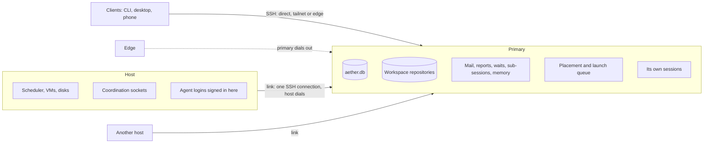
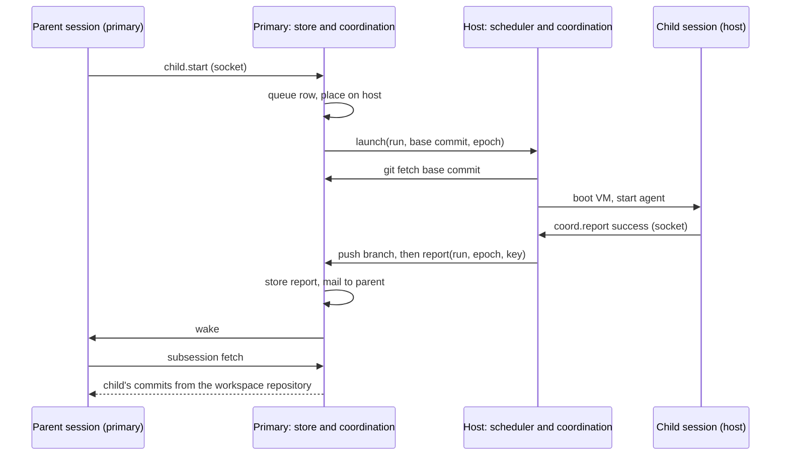

# Running Cloudfield on Several Machines

**Goal:** one person or team runs Cloudfield on several machines of their
own. When one machine is short of memory, a new session or sub-session
starts on another, and agents keep working together across machines.

**Status:** proposed 2026-11-27. Research and a plan; nothing is built. The
owner asked for it on 2026-11-26: "allowing for people to have multiple
machines they can run Cloudfield on, so that if one machine gets congested
or is almost full with RAM or whatever, another machine can pick up the
slack." Section [Decisions for the owner](#decisions-for-the-owner) lists
what only he can settle. [Review](#review) lists what review changed.

Evidence is in
[`research/2026-11-27-multi-machine/`](../../research/2026-11-27-multi-machine/README.md).
`E1` to `E7` below name its files `evidence/01-…` to `evidence/07-…`; each
claim there carries a file and line of this repository, or the URL that
was read.

## Recommendation

1. Keep one server as the **primary**: it keeps the database, members,
   mail between sessions, the git repositories and the dashboard, as today.
2. Other machines join it as **hosts**. A host runs the same
   `cloudfield-server` binary in a host role, dials out to the primary, and
   runs sessions with its own scheduler, VMs, disks and agent logins.
3. A session is placed once, at launch, on the machine with the most room.
   It never moves by itself. A launch that fits nowhere waits in a queue
   in the primary's database; it is not refused.
4. No job queue product. BullMQ, Redis, Postgres, NATS and Temporal are not
   added: a queue re-runs work when a worker goes quiet, which is the one
   thing a session must never do.
5. Ship the single-machine half first (a waiting launch, a `host` on every
   session, numbers on every refusal). It is useful alone and it measures
   whether the second machine is worth building.

## Terms

| Term | Meaning |
| --- | --- |
| Primary | The Cloudfield server as it is today, plus the list of hosts. One per installation |
| Host | A machine that runs sessions for a primary. It has no members, no dashboard and no edge enrolment of its own |
| Link | The one SSH connection a host keeps open to the primary. The host dials it |
| Placement | The primary's record of which machine a session runs on. Written once |
| Machine | The primary or a host, when the difference does not matter |

## Today

One process on one machine holds everything, and the code relies on that.

| What | How it is one machine | Source |
| --- | --- | --- |
| Database | One SQLite file, `aether.db`, with the event log in the same file. The event sequence counter is in memory | `internal/store/sqlite.go:35-60`, `internal/events/inproc.go:29-52` (E3 §1) |
| Sessions | The scheduler keeps one in-memory map of runs and one runtime built at start. `runs` has no host column | `internal/scheduler/scheduler.go:270`, `internal/server/server.go:328-369`, `internal/store/migrate.go:442-458` (E1 §0, §7) |
| Recovery | After a restart every active run in the database is recovered here; a run whose container or sidecar file is missing is ended `interrupted` with `server restarted` | `internal/scheduler/recovery.go:689-725`, `1408-1412`, `1477-1479` (E1 §6 lists 20 such places) |
| Admission | Memory, disk and the server's own stall are measured on this machine; reservations are in memory | `internal/scheduler/capacity.go:32-45`, `309-387` (E1 §1) |
| A refused launch | Fails at once with `-32004`. A queued sub-session that capacity refuses becomes `refused` and is never retried | `internal/scheduler/capacity.go:197-211`, `internal/sshd/errors.go:105-108`, `internal/children/dispatch.go:63-73` (E1 §1) |
| Session identity for coordination | A Unix socket per session on the server's disk. "Nothing on the wire names a sender" | `internal/coord/socket.go:54-59`, `380-384` (E2 §1) |
| Wakes | Go calls from the coordination service into the scheduler, and Go channels | `internal/server/svc_coord.go:33-62`, `internal/coord/mailbox.go:1329-1383` (E2 §3) |
| Git | One bare repository per workspace on the server's disk; checkouts are local clones of it or VM disks beside it | `internal/gitengine/engine.go:220-225`, `internal/gitengine/checkout.go:163-183` (E3 §2) |
| Agent logins | One copy of each login, in the member's home on the server, mounted in place | `docs/security.md:242-244`, `328-332` (E3 §4) |
| Saved VMs | Memory and disks under `<data-dir>/vm/<run id>/`; the saved state names its disks by absolute path; disks, checkouts and images hard-link each other | `internal/runtime/vm/save.go:333-335`, `406-437`, `docs/install.md:155-157` (E1 §3, §4) |
| Reaching the server | One SSH port carries git, control, terminals and events. Through an edge the server dials out | `docs/networking.md:3-7`, `docs/edge.md:18-31` (E3 §7, §8) |

Two things already point at several machines. The runtime package says
"future backends (Podman, firecracker, remote runner nodes) implement the
same interface" (`internal/runtime/runtime.go:1-5`); no such backend exists.
A client already keeps several named server links (`internal/cli/config.go:19-100`),
and one edge account can own several servers
(`internal/edge/store/edgestore.go:204-214`), so a person can run two
unrelated servers today and switch between them.

### The baseline is moving

Pull requests #1153 to #1172 change launch, wake and memory on one machine
(E1, opening section and §9). Merged: #1161, #1163, #1168. Open: #1154,
#1156, #1158, #1162, #1164, and the drafts #1159 (idle VMs paused in
memory, saved to disk only when memory is short or after an hour), #1160,
#1167 and #1172 (huge pages). This plan assumes they land:

- #1158 logs the time of each launch and wake step. The plan's
  measurements use that log.
- #1159 makes a sleeping session hold host memory until the guard saves
  it. A machine then looks fuller than its working sessions make it, and
  placement must count memory the guard can still free
  ([Placement](#2-placement)).
- #1164 moves the mirror fetch out of the server-wide launch lock
  (`authorizationMu`, `internal/sshd/handlers.go:288`). Placement adds a
  network call to a launch and must stay outside that lock too.

### What 2026-11-26 showed

The owner's brief for this plan records that the server ran out of memory
for seven hours on 2026-11-26: its memory guard evicted sessions, sleeping
sessions could not be woken or closed, and queued launches did not start.
No document, commit or pull request in the repository describes that day
(E1 §10), so the brief is the only source.

The code explains each symptom:

- The guard saves VMs to disk to free memory, and a wake must then pass
  admission for the size of the saved memory
  (`internal/scheduler/capacity.go:173-190`). On a full machine every wake
  is refused and the session stays asleep (`docs/failure-handling.md:809-812`).
- A close of a VM session boots the VM to commit its work when the VM is
  gone (`internal/scheduler/evidence.go:150-177`); that boot needs memory
  too.
- A queued sub-session that capacity refuses is not retried
  (`internal/children/dispatch.go:63-73`).

What a second machine would have changed: new sessions and sub-sessions
would have started there. What it would not have changed: the sessions
asleep on the full machine. Their disks and saved memory are on that
machine, and this plan does not move them
([Moving a session](#moving-a-session)). So the first phase fixes the
single-machine behaviour as well.

## The shapes compared

| | (a) Primary and hosts | (b) Peer servers | (c) Separate servers, joined in the client |
| --- | --- | --- | --- |
| Source of truth | One SQLite database on the primary | Each server its own database, kept in agreement | Each server its own; nothing shared |
| Mail, reports, waits, sub-sessions, memory across machines | Unchanged: one store, one writer | Every mechanism needs a cross-server protocol or a replicated database | Do not cross servers |
| Members and roles | One list | Replicated or duplicated | Duplicated by hand |
| New moving parts | A link and a host role | Consensus or CRDT replication, or 11 cross-server protocols | None |
| What dies with one machine | Primary: control of everything. Host: its sessions | That server's sessions | That server |
| Exists today | No | No | Yes, without balancing |

**(b) is rejected.** Coordination is built on one database and one process:
the inbox cap, idempotency keys and delivery tokens rely on SQLite's single
write lock (`internal/store/coord.go:312-351`); the wait evaluator has one
cursor row (`internal/store/watch_notify.go:228-242`); the event bus has one
counter (`internal/events/inproc.go:20-27`); E2's table marks all eleven
mechanisms "same database". Peers would need a replicated database. The
systems that do this run Raft on three or five servers (Nomad, Incus;
E4 A1, F1), and Incus requires member latency under 10 ms (E4 F2), which
home machines behind NAT do not have. Fly replaced consensus with a gossip
database across thousands of hosts (E4 C1); that is a different scale and a
different company. Two machines cannot form a quorum at all.

**(c) is kept as it is and not extended.** It costs nothing and already
works for a person who wants two fully separate servers. It cannot balance:
a parent on one server cannot start a child on the other, and agents cannot
message across them.

**(a) is recommended.** It is what the dev-environment and CI systems with
self-hosted workers do: one control plane with the database, workers that
dial out (E6 comparison table). Gitpod's account of leaving Kubernetes
gives the reason sessions stay where they start: environments "cannot be
moved from one node to another" and their source, caches and data are
"costly to migrate" (E6 B).

### Thin host or full host

Inside (a) there are two cuts (E7 weighs them against the code).

| | Thin host | Full host (recommended) |
| --- | --- | --- |
| What runs on the host | Only a remote `runtime.Runtime`; the primary's scheduler drives it | The server binary in a host role: scheduler, runtime, coordination sockets, git checkouts, terminals and agent connections for its own sessions |
| Link drop | Every exec, terminal and agent stream dies; the primary cannot tell a dead VM from a dead link | Sessions keep working; mail and reports wait |
| Host-local paths the primary touches | Checkout, coordination directory, sidecar, home, transcripts, VM directory: all would have to be remote | None |
| Member home | Served across the link for every file operation | A home on the host |
| Size | A remote runtime plus every path above | A host role plus a split of the store and bus along interfaces that exist |

See [The seam](#the-seam) for the evidence and the size.

## 1. The shape

### What a person installs on machine two

1. The same install script and binary as a server
   ([install.md](../install.md#the-install-script)), with the VM host
   prerequisites ([install.md](../install.md#hosts-for-vm-sessions)).
   Hosts run session VMs only; a Docker-only machine has no memory guard
   (`internal/scheduler/vm_memory.go:39-42`) and is not accepted as a host.
2. On the primary, a super admin creates a join code. It follows the claim
   code that exists: single use, 30 minutes, 5 attempts
   (`docs/edge.md:219-221`). The code carries the primary's address and its
   server id, which is the hash of its host key
   (`internal/edge/proto/id.go:15-25`), so the host checks the primary's
   key before it sends anything, as a client does.
3. On machine two: `sudo cloudfield-server host join '<join link>'`. The
   host creates its own key, dials the primary's SSH port, presents the
   code once, and the primary records the host's public key. From then on
   the key is the host's identity. The command names are proposals.
4. The host appears in **Settings → Machines** as *joined, not taking
   sessions*. It takes sessions after it passes its checks (KVM, Cloud
   Hypervisor and kernel of the primary's release, disk, the standard
   image) and a super admin turns it on.

The host needs to reach the primary's SSH port: on a LAN, over a tailnet,
or at a public address. The host opens no port. That matches the systems
read: GitHub's runner, GitLab Runner, Buildkite agents, Cursor's workers,
Claude Code's self-hosted runners and Daytona's runners all dial out and
need no inbound port (E6 E, F; E4 E).

A link through the edge relay is left out of the first phases. The relay
admits account devices, by a grant that names an account and a device
(`internal/sshd/edge.go:62-120`); it caps a server at 48 SSH connections
and throttles all traffic to 256 KiB/s once its egress budget is spent
(`internal/edge/proto/limits.go:9-61`, `docs/edge.md:1247-1255`). Git packs
and terminal streams of a whole machine do not fit that budget. See
[Decisions](#decisions-for-the-owner).

### What breaks on machine one while a host joins

Nothing. A join writes one row and opens one connection. The primary's
sessions, its scheduler and its recovery do not read the host list. The
only restart is the ordinary update to the release that has the feature,
which waits for an idle moment as updates do today
(`docs/install.md:938-961`).

## 2. Placement

### What says a machine is full

Each machine keeps deciding for itself, with the checks that exist. Nothing
about them moves to the primary.

| Check | Rule today | Source |
| --- | --- | --- |
| Memory | `MemAvailable` ≥ `max(2 GiB, total/10)` + 512 MiB for this start + what admitted starts have yet to take | `internal/scheduler/capacity.go:37`, `105-107`, `213-220` |
| Stall | The server's cgroup `memory.pressure` `some avg60` under 10 | `internal/scheduler/capacity.go:44`, `368-371` |
| Disk | Free ≥ `max(5 GiB, min(total/20, 20 GiB))` + 1 GiB per start in flight | `internal/scheduler/capacity.go:97-102`, `321-334` |
| Brake | Under the memory floor every session VM is frozen, checked every 500 ms | `internal/scheduler/vm_freeze.go:18`, `73-83` |
| Guard | Under the floor, or stalled 30 s, it saves one VM to disk every 5 s | `internal/scheduler/vm_memory.go:19-23`, `85-103` |

There is no CPU check and no session count limit (E1 §0). PR #1130
measured one vCPU per session sandbox on the production server and launch
refusal at 10% pressure; this plan uses those numbers and does not repeat
the measurement.

### Where a new session goes

Each host reports over the link, every few seconds and on change: memory
available, the floor, memory already claimed, the stall figure, free disk
per filesystem, how many VMs are awake, paused, frozen and saved, and how
much memory the guard could free by saving idle VMs. These are the inputs
admission already computes.

The primary places in two steps, as Nomad and Kubernetes do (filter, then
score: E4 A3, B3):

1. **Filter.** Keep the machines that are connected and turned on, run a
   compatible release, are allowed for the workspace, hold the session's
   image, and hold the login the session will spend
   ([Agent logins](#agent-logins)).
2. **Score.** Pick the machine with the most memory above its floor after
   subtracting claims. Count memory held by paused idle VMs as free, since
   the guard frees it before refusing (`internal/scheduler/vm_memory.go:145-184`).
   Prefer the parent's machine for a sub-session when it is within a
   margin of the best: a child on the same machine fetches its base and
   returns its commits without the link.
3. **Ask.** The primary sends the launch to that machine. The machine runs
   its own admission and answers. A capacity refusal is an answer, not an
   error: the primary tries the next machine. This is E2B's rule, a node
   that answers "exhausted" stays eligible and the caller retries
   elsewhere (E4 E3).

The score uses measured memory, not limits: limits are 8 GiB per session
by default and are never counted (`docs/failure-handling.md:330-331`),
while a booted 2 GiB VM held 159 MiB (`docs/failure-handling.md:333-335`).

### When nothing fits

The launch waits. A row in the primary's database holds it, the session
list shows it as *Waiting for a machine* with each machine's reason
(`insufficient host memory headroom` on one, `unreachable` on another), and
the person can cancel it or start it anyway on a named machine. The primary
tries again when a machine reports more room and on a timer. A waiting
launch that no machine takes within a day ends with the last refusal as
its reason.

Sub-sessions already queue in `run_children` with state `queued` for the
per-parent limit (`internal/children/dispatch.go:17-48`). The same row
waits for capacity: a capacity refusal returns the child to `queued`
instead of `refused`. Nomad and Kubernetes do the same (a blocked
evaluation, an unscheduled pod: E4 A3, B3); Fly refuses and leaves the
retry to the caller (E4 C3), which is what Cloudfield does today.

A wake is different. It goes to the machine that holds the session's disks,
always. When that machine refuses, the session stays asleep with the
refusal shown, as today.

### Moving a session

A session does not move in the phases planned. The options, and why not:

| Way | What it takes | Verdict |
| --- | --- | --- |
| Live migration | Cloud Hypervisor does it over TCP with mutual TLS; disks "must be available at the same paths on both machines"; a heterogeneous fleet needs a matching CPU profile, available from v55 (E4 D3). Cloudfield pins v54.1 and passes no CPU model (`internal/runtime/vm/engine.go:544`) | Not built. It needs shared storage, which this plan refuses |
| Restore a saved VM on another machine | The saved state names disks by absolute path and drops itself when a disk moved (`internal/runtime/vm/save.go:406-437`); the tap, the vsock and the home file service are per machine. Firecracker requires "identical" hardware and software for this (E4 D1); Cloud Hypervisor's page does not state its rule | Not built. Not established that it works at all across two CPUs |
| Copy the disks, start from disk | Checkout disk, state disk and root layer, sparse, over the link. Processes, shell tabs and nested Docker state are lost, as in a cold start today (`docs/failure-handling.md:922-932`). Fly moves a volume this way: stop, copy, boot (E4 C6) | Phase 3, only if the numbers ask for it |
| Start again from the branch | A new sandbox on another machine from the session's last pushed commit. Uncommitted and ignored files are lost unless the old machine returns | Phase 2, as an explicit act by a person |

"Picking up the slack" therefore means: new work goes where there is room,
and a full machine empties as its sessions end or are saved. It does not
mean a busy machine sheds running sessions.

## 3. BullMQ and job queues

**No: a job queue is not the tool for placing sessions, and none is added.**

A queue hands a unit of work to whichever worker asks, and when that worker
goes quiet it hands the work to another. Every queue read says so in its
own words (E5):

| Queue | When the worker goes silent |
| --- | --- |
| BullMQ | The job "is automatically restarted; it will be double processed". Default lock 30 s |
| River | Jobs "still running after this duration will be rescheduled to run again". Default one hour |
| asynq | A killed server's task ran again about 73 s later, "at least once" |
| NATS JetStream | Redelivered after `AckWait` (30 s); "may be processed twice" |
| Temporal | An activity "may be executed multiple times" |

Each tells you to make the work idempotent. A session is not: it is a
process that runs for hours or days with a conversation, a disk and open
terminals, and a second copy of it pushes conflicting commits and spends a
second login. A host that goes quiet is usually partitioned, not dead; its
sessions are still running. The schedulers built for long-lived work treat
that case with care for the same reason: Kubernetes never force-deletes a
StatefulSet pod on an unreachable node, to keep "at most one Pod with a
given identity" (E4 B5).

What in this plan is queue-shaped, and what it uses:

| Need | Used | Why not a product |
| --- | --- | --- |
| A launch waiting for room | A table in `aether.db` and the dispatch loop that exists (`internal/children/service.go:143-160`: every 3 s, and on events) | A handful of rows, one consumer, already transactional with the session row |
| Host events going up | A numbered log on the host, acknowledged by the primary | Order matters and nothing is re-run; that is a log, not a job queue |
| Commands going down (launch, wake, stop) | Calls on the link with the idempotency keys the protocol already has | The answer is needed at once |

What each candidate would cost a single Go binary with SQLite on someone's
own hardware (E5):

| Candidate | Extra to run | Fit |
| --- | --- | --- |
| BullMQ | Redis 6.2+ with `maxmemory-policy noeviction` and AOF, or PostgreSQL 13+ since v6 (2026-07-30). Node, or the official Go port, which is v0 and published 2026-11-25 | A second stateful service to install, back up and secure on every primary, for a problem that is a few rows |
| River | Postgres. Its SQLite driver uses the same pure-Go SQLite as Cloudfield and is "experimental" | The closest fit if Cloudfield ever needs background jobs. Not needed here |
| asynq | Redis | As BullMQ, in Go |
| NATS JetStream | Nothing: the server embeds in a Go program (from its source; no official guide found) | A broker with its own accounts, storage and cluster settings for one link per host |
| Temporal | Four services and Cassandra, PostgreSQL or MySQL | Larger than Cloudfield |

BullMQ fits what the owner used it for: many short jobs that are safe to
run twice. If Cloudfield grows such work (bulk imports, scheduled reports),
the answer is River or a jobs table, decided then.

## 4. Agents talking across machines

### The design in one paragraph

A session keeps talking to a Unix socket on its own machine, so its
identity stays what it is today. The host's coordination service answers
what is local and forwards the rest to the primary over the link, adding
which session called. The primary's store stays the only place mail,
reports, waits, sub-sessions and memory are written. To reach into a
session (a wake, a prompt, a terminal) the primary sends a call down the
link, and the host's scheduler does what the primary's scheduler does
today.

### Each mechanism

| Mechanism | Where it assumes one machine today | Across machines |
| --- | --- | --- |
| Session identity | The socket is the identity; the listener is on the server's disk (`internal/coord/socket.go:335-385`) | Unchanged on each machine. The host tells the primary which session called; the primary accepts that only for sessions placed on that host at the current epoch |
| `send`, `ask`, `reply` | One transaction in the one database (`internal/store/coord.go:312-351`) | The host forwards the call. The primary runs the same transaction. The caller's idempotency key travels with it, so a retry after a dropped link stores nothing twice (`internal/coord/mailbox.go:1308-1327`) |
| `inbox`, `ack` | Batches and tokens in the store; the long poll is a Go channel (`internal/coord/mailbox.go:438-479`) | The read is a forwarded call. The long poll parks on the host; the primary sends "mail for this session" down the link to release it |
| Wakes | A Go call into the scheduler that owns the session (`internal/server/svc_coord.go:58`) | The primary keeps the owed-wake state and its retries (`internal/coord/acp_wake.go:58-88`); the wake itself is a call down the link to the host's scheduler. Unreachable host: the wake stays owed |
| Turn-state reports (`run.report`) | A Go call into the scheduler (`internal/coord/report.go:269-326`) | Stays on the host; the resulting status change goes up as an event |
| Outcome reports | Reserve, capture evidence from the checkout and transcript, finalize, mail the parent (`internal/coord/mailbox.go:528-725`) | The host captures evidence where the checkout is, pushes the branch and evidence refs, then forwards the report. The primary stores it and mails the parent |
| Wait conditions (`--until`) | One watch service, one cursor, GitHub polled with the owner's token from their home (`internal/watch/service.go:98-123`, `internal/github/github.go:67-79`) | Stays on the primary, unchanged. Its wake is mail, which travels as above |
| Sub-sessions | The child launches on the same scheduler; the per-parent slot count is a database query (`internal/children/dispatch.go:23-60`) | The primary dispatches and places. The slot count is already machine-neutral |
| A parent fetching a child's commits | Local paths: child checkout → workspace repository → parent checkout (`internal/children/agent.go:332-353`) | The workspace repository on the primary stays the midpoint. A host pushes a child's branch up and fetches into a parent's checkout over the SSH port, as a client does today (`internal/sshd/session.go:82-96`) |
| Status and peers | The store's live sessions joined with the in-memory overlap index (`internal/coord/peers.go:119-238`) | A forwarded call. Each peer also carries its machine and whether that machine is reachable |
| Overlap warnings | An in-memory index fed by `run.diff` events from the bus (`internal/overlap/index.go:63-136`) | Stays on the primary. A host's diff watch publishes `run.diff` up the link; the index does not know the difference |
| Team memory | SQLite full-text search (`internal/store/memory.go:422-470`) | A forwarded call |
| Session MCP tools | A stdio bridge to the local socket (`internal/mcpbridge/mcpbridge.go:51-84`) | Unchanged |
| `co-authors` and other files | Written by the server into the session's directory (`internal/scheduler/coauthors.go:375-402`) | The primary sends the change down; the host writes the file |
| `dev.terminal`, `dev.browser`, captures | The scheduler and runtime on the session's machine (`internal/scheduler/development.go:264-330`) | Stay on the host. A retained capture is uploaded with the evidence |

### Who connects to whom

The host dials the primary and keeps one SSH connection. Both directions
use it: calls up, calls down, the event stream, and one channel per live
stream (a terminal, an agent conversation, a port forward). Nothing dials a
host, so a host behind NAT works, and two hosts never talk to each other.
A message from a session on host A to a session on host B goes A → primary
→ B.

Channels stay open and are reused. PR #1175 measured why: with a new SSH
channel per request, one call over a 150 ms link cost 453 ms, three round
trips (E3 §6).

### Source of truth

| Fact | Owner |
| --- | --- |
| That a session exists, whose it is, where it is placed | Primary |
| Mail, reports, waits, sub-session rows, memory, the event log | Primary |
| Branch tips of record | Workspace repository on the primary |
| Whether the VM runs, sleeps or is frozen; its disks; its sidecar | The machine it is on |
| Session status shown to people | Primary, from the host's events; marked stale while the host is unreachable |

### A message while a machine is unreachable

- **Recipient's host is unreachable.** The send succeeds: the mail is a
  row on the primary. The receipt's recipient status says `unreachable`,
  beside `sent`, `held`, `delivered`, `acked` and `retired`. The wake is
  owed and fires when the host returns. This is what happens today to mail
  for a session that cannot be woken: it stays unread
  (`docs/coordination.md:337`).
- **Sender's host is cut off.** The send fails with the real error after
  the client's own retries (up to 60 s today, `docs/coordination.md:299-335`).
  Nothing is half sent: the store write is one transaction, and the retry
  carries the same key.
- **The primary is down.** Every send, read and report fails with the real
  error. Sessions keep running. Reports are the cost: an agent that
  finishes a turn cannot report until the primary is back.

### Ordering and delivery

Nothing changes, because one database still decides.

- Mail to one session is delivered oldest first by insertion order, at
  least once, one frozen batch per token until acknowledged
  (`internal/store/coord.go:538-565`).
- A mutation takes effect once: the unique index on sender and idempotency
  key refuses a second copy (`internal/store/coord.go:292-348`).
- A wake for one set of unread mail is offered at most once per primary
  process (`internal/coord/acp_wake.go:114-215`); after a primary restart it
  may be offered once more, as today (E2, Not established).
- Events from one host keep their order: the host numbers them, the
  primary applies them in order and ignores a number it has seen. Events
  from two hosts interleave in arrival order.

### What an agent sees when its peer's machine is gone

- `status` lists the peer with `machine: <name>, unreachable since <time>`.
- `send` to it returns a receipt with recipient status `unreachable`.
- A parent gets one mail when a child's machine becomes unreachable and
  one when it returns, in addition to the notices that exist (quiet for an
  hour, stopped for a minute: `internal/children/dispatch.go:281-285`).
- A wait on `run:<id>:finished` does not resolve while the machine is
  unreachable. It resolves as failed when a person declares the machine
  lost ([Failure](#6-failure)).
- `subsession fetch` returns the commits the primary has, and says they
  may be behind.

## 5. State

| State | Today | With hosts |
| --- | --- | --- |
| Database | SQLite, one writing process, plus short-lived admin commands (`cmd/aether-server/member.go:30`) | Unchanged, on the primary. One writer. A host has no copy of it |
| Host's own state | — | Per-session sidecar files, as today (`internal/scheduler/state.go:416-487`), and a small local record of its placements and unsent events |
| Workspace repositories | `repos/<workspace>.git` | On the primary. A host keeps a clone as a cache and fetches the base commit at launch |
| Session branches | Published from the checkout into the workspace repository at launch, steer, recovery and evidence (`internal/gitengine/checkout.go:401-445`) | The host pushes them up at the same moments and on each commit it sees. A commit counts as safe once the primary has it |
| Diff history | `checkouts/<run-id>.diffsnap/` beside the checkout | On the host while the session lives; the snapshot trees go up with the branch so **Changes** works from the primary |
| Evidence | Metadata in the database, files under `evidence/`, refs in the workspace repository | Captured on the host, stored on the primary |
| Transcripts | `transcripts/<run>.cast` and `.items.jsonl`, written by the server (`internal/ptyhost/ptyhost.go:588`) | Written on the host, uploaded in acknowledged segments, complete on the primary when the session ends |
| Member home | `homes/<member>/`, one per member | One per member per machine. Configuration is copied by the rules of `cloudfield config push`, which skips credential files (`docs/security.md:825-843`) |
| Agent logins | One copy, mounted in place | See below |
| gh token | `~/.config/gh/hosts.yml` in the home (`docs/security.md:477-487`) | Copied to a host's home when the member first signs an agent in there. The primary keeps its copy for mirrors and waits |
| Commit signing key | `signing-keys/<member>`; lent through an agent socket (`docs/security.md:489-499`) | Never leaves the primary. The host relays the socket up the link |
| Workspace secrets | A file per workspace; injected at creation (`docs/security.md:552-564`) | Sent in the launch, only to machines the workspace allows |
| Linear keys, Slack tokens, mirror deploy keys, push key, connector key | Files on the server | Stay on the primary. A host never sees them |
| VM disks, saved memory, images, caches | `vm/` | On the machine that runs the session. Never copied. The standard image is fetched by each host from the signed release; a saved environment is copied to a host on first use there |
| Terminals and live streams | The server's `ptyhost` fans out to clients (`internal/ptyhost/session.go:62`) | The host holds the terminal; the primary relays the stream to the client over a link channel |
| Dashboard event stream | The in-process bus (`internal/events/inproc.go:138-149`) | Unchanged; host events enter the same bus |
| Budgets | Per workspace, in the database, checked at launch (`internal/cost/service.go:380-405`) | Checked on the primary before placement. Costs go up as events |
| Vendor usage | Read with the login's credential, cached in memory 60 s (`internal/quota/service.go:73-81`) | Read by the machine that holds the login, reported up |
| Edge enrolment | One per server id; the id is the host key's hash | The primary only. See below |
| Connector addresses | Embed the server id (`internal/server/server.go:736-745`) | Unchanged |
| Push, Slack, watches, assistant | One per server process (E3 §12) | Stay on the primary |

### Agent logins

Claude Code and Codex replace the refresh token on every refresh, and the
repository's rule follows from it: "a refresh kept only in the copy would
leave your real login revoked" (`docs/security.md:242-244`). Writing a
login into an old copy "forks the refresh-token chain"
(`docs/plans/2026-11-03-shared-account-credentials.md:137-147`). A refresh
done centrally by the server was built and removed after it failed its
canary (same plan, lines 7-10). Whether a vendor tolerates one login
refreshed from two machines is not established (E3 §4).

So a login is never copied between machines:

- A login lives on the machine where the member signed it in. "Sign in on
  *machine*" runs the sign-in that exists
  (`internal/scheduler/agent_logins.go`) on that machine. The vendor sees
  it as another device, as it sees a person's laptop and desktop.
- The `agent_logins` table from #1142 gains the machine. A member with
  logins on two machines has two rows.
- Placement keeps only machines that hold a login the session may spend.
  The move between logins in #1149 chooses among logins on the session's
  own machine.
- A shared account's session runs where the owner's login is, since it
  mounts that file (`docs/security.md:328-333`).
- `omp` already works through a broker that holds the one copy and hands
  sessions access tokens only (`docs/harnesses.md:738-754`). The broker
  stays on the primary and a host's sessions reach it over the link.

The cost is real: a member signs in once per machine per login, and a
machine nobody signed in to takes none of that member's sessions.

### The edge

Only the primary enrols. The relay keeps one registration per server id and
a new one replaces the old (`internal/edge/relay/control.go:218-226`), so two
machines with one host key would evict each other. Hosts never hold the
primary's host key. Clients, invitations, device approval and connector
addresses do not change.

### Updates and versions

- The primary updates first. That is the rule for clients today: "A server
  refuses any client older than itself" (`docs/install.md:1072-1083`).
- The link has its own protocol version with a minimum, as the edge
  protocol does (`internal/edge/proto/edgeproto.go:13-45`). A host on an
  older release keeps its sessions connected while its link version is
  accepted, takes no new sessions, and shows *needs update*.
- A host follows the primary's release channel and updates itself from the
  signed release at its next idle moment, with the updater that exists.
  The primary never sends a host a binary.
- A host keeps a running or saved VM's kernel, helper disk and Cloud
  Hypervisor until that VM stops, as a server does
  (`docs/install.md:801-806`). Sessions never cross machines, so two
  machines on different releases never share a saved VM.

## 6. Failure

The rule: **the primary never starts a session a second time by itself.**
An unreachable machine is shown as unreachable and its sessions are left
alone. This is Kubernetes' rule for StatefulSets (E4 B5), and the opposite
of Nomad's default, which replaces at once and whose own documentation
says "the server may reschedule the group before the client has stopped
the allocation" (E4 A5). Among agent runners, Claude Code's self-hosted
runners requeue a session to another runner about a minute after a runner
stops polling (E6 F); they can, because the conversation is kept by the
vendor and not on the runner. A Cloudfield session's disk, processes and
login are on its machine. The CI systems split the same way: GitLab and
Buildkite do not re-run a lost job unless told to (E6 E).

| What happens | What is lost | What recovers by itself | What a person does |
| --- | --- | --- | --- |
| The primary restarts | Nothing | Hosts keep their sessions running, hold their events and reconnect. Coordination calls retry | Nothing |
| The primary's machine dies | Control of everything until it is back; what the primary's own sessions had not committed | Sessions on hosts keep working in their sandboxes and can push to GitHub with their own credentials | Restore the primary from its backup ([install.md](../install.md#what-lives-in-the-data-directory)). The primary stays a single point of failure, as the server is today |
| A host loses its link | Nothing | Its sessions keep working. Mail to them waits; their events are held on the host's disk and sent in order on reconnect | Nothing |
| A host loses power | Processes and memory of its sessions; VMs paused in memory (#1159) | On boot, the host's recovery reattaches or ends each session as a restarted server does today (`internal/scheduler/recovery.go:1399-1494`). Saved VMs wake. Pushed commits were never at risk | Nothing, if it comes back |
| A host is gone for good | Whatever its sessions had not pushed | — | Declare it lost in **Settings → Machines**. Its sessions end `interrupted` with reason `machine lost`; waits on them resolve as failed; each can be started again from its branch |
| A host returns with older state (a restored disk image) | — | The primary sees event numbers below those it acknowledged, and refuses the link | An admin chooses: discard the host's sessions, or keep the host out |
| Two machines claim one session | — | The primary accepts calls, events and pushes for a session only from the machine and epoch in its placement. The other is told to destroy its copy before anything else it sends is read | Nothing |
| Two hosts present one key (a cloned disk) | — | The primary keeps the link that is open and refuses the second | Rejoin the clone under a new key |

### Why a session cannot run twice

- Placement is one row written in one transaction on the primary before
  any machine is asked. It carries an **epoch**, a number that only grows.
- A host starts a session only on a launch call that names the epoch, and
  the launch is idempotent on the session id: the VM's key is the run id
  (`internal/runtime/vm/vm.go:100-122`).
- In phase 1 a placement is never rewritten, so there is no second machine
  to run it. The disks exist on one machine only.
- Phase 2 lets a person start a session again elsewhere. That raises the
  epoch, so everything the old machine sends for that session is refused.
  To stop the old copy while it is cut off, a host holds a **lease** it
  renews over the link. A host that cannot renew for 10 minutes freezes
  its session VMs, with the cgroup freeze the brake uses, which "needs no
  process" in the VM or the hypervisor to cooperate
  (`internal/runtime/vm/freeze.go:31-38`). A systemd timer the host
  re-arms on each renewal does the freeze, so it still happens when the
  host's server process is the part that died: a VM lives in its own unit
  and outlives that process (`internal/runtime/vm/unit.go:20-21`). The
  primary offers "start again elsewhere" 15 minutes after the last
  renewal, or at once when a person states the machine is powered off,
  which is Kubernetes' `out-of-service` taint (E4 B5).
- What the lease cannot cover: the minutes before the freeze. In them the
  old copy can still push to GitHub with the member's token. Cloudfield's
  own state is fenced; the outside world is not. The dialog says so.

### Why pushed work cannot be lost

A commit is safe once the workspace repository on the primary has it. A
host pushes a session's branch at every moment the server publishes it
today, on every commit its watch sees, and before it forwards an outcome
report: a report never reaches a parent before the commits it describes.
What can be lost is what was not yet pushed on a machine that never
returns, the same exposure as an uncommitted checkout on a dead server
today (`docs/install.md:1162-1166`).

## 7. Security

### Who can join

Only a super admin creates a join code; super admins already "manage
members, roles and the server itself" ([teams.md](../teams.md#roles)). The
code is single use and short lived. The host pins the primary's key from
the code; the primary pins the host's key from the join. Both directions
then use SSH public keys, the transport every client uses. A host is
removed with one click, which drops its key and closes its link.

### What a host may do

The primary treats a host as it treats nothing else today: a machine, not
a member. Its rights follow Kubernetes' node rules, where a kubelet reads
only what belongs to pods bound to it and changes only its own node
(E4 B7):

- It acts only for sessions placed on it, at the current epoch.
- It fetches and pushes only the repositories of workspaces that have a
  session placed on it, and pushes only those sessions' branches and
  evidence refs.
- It receives only the secrets of those workspaces.
- It cannot read the database, list members, reach another workspace, or
  open a stream to a session on another machine.
- Every decision about who may view, steer or kill a session is taken on
  the primary before a stream is relayed. A host has no members to ask.

### What a compromised host gets

Everything inside the sessions it runs, which is what a compromised server
gets today for all sessions:

- The agent logins signed in on it, and the gh tokens copied to it. A
  login signed in on another machine is not there.
- The secrets and source of the workspaces it ran.
- The ability to send mail, reports and memory notes as its own sessions,
  within the limits that apply to any session (4 KiB a message, 100 unread,
  20 notes: `docs/security.md:1097-1130`), and to ask the primary to sign
  commits as the members whose sessions it runs.

What it does not get: the database, other machines' sessions, signing
keys, Linear keys, Slack tokens, mirror deploy keys, the edge enrolment,
homes on the primary, or a login on any other machine.

### What a compromised primary gets

Everything, as today. It can also start any session on any host. A host's
owner trusts the primary's super admins as a member trusts the server's
administrator: "what a server holds is its administrator's"
(`docs/privacy.md:621-629`).

### Limiting where a workspace runs

A workspace can name the machines it may use. Its secrets and source then
reach no other machine. This is the control for a team that mixes a
company server with a teammate's own machine. A session's machine is shown
wherever its account is shown.

### In transit and at rest

In transit: SSH with pinned keys, both ways. At rest: a host's data
directory follows the server's rules (homes owner-only, logins `0700` and
`0600`). The database gains no secret. A removed host still holds what it
held: removing one tells each affected member which logins and tokens were
on it, so they can revoke them at the vendor.

## The seam

*Filled from E7 when the analysis lands.*

## 8. The path

Each phase ships alone. Sizes are counts of pull requests, the author's
estimate, not measurements.

### Phase 0: one machine that waits and explains

- A launch that capacity refuses waits instead of failing: sub-sessions
  stay `queued` and are retried; an interactive launch becomes a visible
  *Waiting for memory* row a person can cancel.
- Every session records its machine (`runs.host`, one value today).
  Recovery and the sweeps that list every active run filter by it (E1 §6).
- **Settings → Machines** shows the one machine: memory against the floor,
  the stall figure, disk, VMs awake, paused, frozen and saved, and why the
  last launch or wake was refused. `cloudfield-server status` prints the
  same.
- Every refusal, queue wait, freeze and guard save is counted and logged.

After it: a busy server stops dropping sub-sessions, and a person sees why
a launch waits. Cost: about 4 pull requests, no new protocol. Left undone:
sleeping sessions on a full machine still cannot wake until memory frees.

### Phase 1: a second machine takes sessions

| Step | After it a person can |
| --- | --- |
| 1a. Join, link, heartbeat, capacity report, cordon | See a second machine in **Settings → Machines** with live numbers. It runs nothing yet |
| 1b. Launch Enhanced and Background sessions on a host: launch call, git over the link, events up, coordination forwarded, wakes down, chat relayed, per-machine sign-in | Have sub-sessions and new sessions start on machine two and talk to sessions on machine one |
| 1c. Terminals, SSH into a session, port forwards, the browser, files and captures on a host | Use a session on machine two exactly as one on machine one |
| 1d. Placement by room, the queue across machines, per-workspace machine lists, drain | Stop choosing machines |

Cost: comparable to the microVM migration, which was 13 work items
(`docs/plans/2026-11-13-microvm-sessions.md:115-134`). Left undone: a
session never moves; a lost host's sessions end.

### Phase 2: losing a machine cleanly

The lease and freeze, *declare lost*, *start again from its branch on
another machine*, quarantine of a host that returns with older state, and
host updates driven from the primary's Updates page. Cost: about 6 pull
requests. Left undone: moving a sleeping session.

### Phase 3: move a sleeping session, only if measured

Copy a sleeping session's disks to another machine and start it from disk
there. Built only if phase 0's numbers show that sessions asleep on a full
machine are the problem that remains.

### What to measure before committing to phase 1

Phase 0 gives the counters. Two weeks of them on the production server
answer:

- How many launches and wakes were refused or waited, and for how long?
  If waiting launches clear within minutes, the queue alone may be enough.
- Of the memory in use at each refusal, how much was held by sessions idle
  for over an hour? If most, the fix is the guard's policy, not a machine.
- How many refused wakes? They are the part a second machine does not fix.

And one spike before 1b, on two real machines over a tailnet: round-trip
time and throughput of the link, link drops per day, the size of a
session's pushes, and how long a launch on the far machine takes with
#1158's step log.

### What not to build

- Peers, consensus, a replicated database, or Postgres for the server.
- A job queue product or a broker.
- Shared network storage for the data directory. SQLite in WAL mode does
  not work on one (E5 F), and the VM disks hard-link each other on one
  filesystem (`docs/install.md:155-157`).
- Live migration, or restoring a saved VM on another machine.
- Automatic restart of a session on another machine.
- A second primary or automatic failover of the primary.
- A network between sessions on different machines. Sessions cannot
  connect to each other today (`docs/security.md:25`).
- Cloud autoscaling. A host is a machine a person adds.
- A separate host binary. One binary, one release.

## Decisions for the owner

1. **Sign in per machine, or copy logins?** Recommended: sign in per
   machine. It is more clicks, and it is the only choice the repository's
   own login rule allows without betting on vendor behaviour nobody
   measured.
2. **May a host link run through the hosted edge?** Recommended: not yet.
   Tailnet, LAN or a public address first. It needs a host grant in the
   edge protocol and a decision on who pays for a machine's traffic.
3. **Whose machines?** Recommended: hosts are added by a super admin and
   shared by the team, with a per-workspace list of allowed machines. A
   member attaching a personal machine for their own sessions only is a
   later step.
4. **Build phase 1 now, or after two weeks of phase 0's numbers?**
   Recommended: ship phase 0, then decide with the numbers.

## Not established

- What happened on 2026-11-26 beyond the brief's summary. Nothing in the
  repository records it (E1 §10).
- Whether a vendor tolerates one login refreshed from two machines (E3 §4).
- Whether Cloud Hypervisor v54.1 restores a saved VM on another machine or
  CPU, and which releases accept another release's snapshot (E1 §3, E4 D2).
- An end-to-end launch time on a production server (E1 §9).
- Round-trip time and throughput through the hosted edge, and whether it
  enforces its egress budget (E3 §6).
- How the edge behaves when two machines enrol one server id repeatedly
  (E3 §8). The plan avoids it.
- The size of a real `aether.db`, and of a typical session's pushes.
- For Fly, E2B, Daytona and Incus: what a compromised host can read, and
  how a returning host is fenced. Their documentation does not say (E4).
- Everything in phase 1 that only a prototype settles; see
  [The seam](#the-seam).

## Review

*Filled after the three reviews.*
