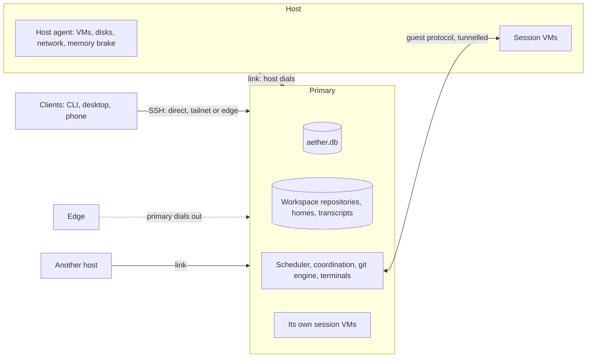

# Running Cloudfield on Several Machines

**Goal:** one person or team runs Cloudfield on several machines of their
own. When one machine is short of memory, a new session or sub-session
starts on another, and agents keep working together across machines.

**Status:** proposed 2026-11-27. Research and a plan; nothing is built. The
owner asked for it on 2026-11-26: "allowing for people to have multiple
machines they can run Cloudfield on, so that if one machine gets congested
or is almost full with RAM or whatever, another machine can pick up the
slack." [Decisions for the owner](#decisions-for-the-owner) lists what only
he can settle; they were decided on 2026-11-27. [Review](#review) lists
what review changed.

The sections phase 0 builds on ([Today](#today), [What says a machine is
full](#what-says-a-machine-is-full), [When nothing fits](#when-nothing-fits))
were checked again against `main` at `2cee7b1ba` on 2026-11-27 and
corrected. File and line references elsewhere are as of the plan's writing
and may have moved.

Evidence is in
[`research/2026-11-27-multi-machine/`](../../research/2026-11-27-multi-machine/README.md).
`E1` to `E7` below name its files `evidence/01-…` to `evidence/07-…`; each
claim there carries a file and line of this repository, or the URL that
was read.

## Recommendation

1. Keep one server as the **primary**. It keeps everything it has today:
   the database, members, mail between sessions, git, the dashboard, and
   the scheduler that supervises every session.
2. Other machines join as **hosts**. A host runs session VMs and what they
   need on their machine: Cloud Hypervisor, the disks, the VM network, the
   memory brake. It has no scheduler and no database. It dials out to the
   primary, and the primary drives each VM through that link with the
   protocol it already speaks to a VM on its own disk.
3. A session is placed once, at launch, on a machine that everyone whose
   data it carries allows and that has the most room, and stays there. A
   launch that fits nowhere for now waits in a queue in the primary's
   database; it is not refused.
4. A host that loses its link for longer than a grace period freezes its
   VMs until the link is back, and Cloudfield never starts a second copy
   of a session by itself. Work on a host pauses when the primary is down
   for longer than that.
5. No job queue product. Ship the single-machine half first (a waiting
   launch, a count of every refusal): it is useful alone and it measures
   whether a second machine is worth building. A two-machine spike with
   pass and fail criteria decides whether this cut is built at all.

## Terms

| Term | Meaning |
| --- | --- |
| Primary | The Cloudfield server as it is today, plus the list of hosts. One per installation |
| Host | A machine that runs session VMs for a primary. It has no database, members, dashboard or edge enrolment |
| Host agent | The program on a host: `cloudfield-server` started in a host role |
| Link | The one SSH connection a host keeps open to the primary. The host dials it |
| Placement | The primary's record of which machine a session's VM is on. Written once |
| Machine | The primary or a host, when the difference does not matter |

## Today

One process on one machine holds everything, and the code relies on that.

| What | How it is one machine | Source |
| --- | --- | --- |
| Database | One SQLite file, `aether.db`, with the event log in the same file. The event sequence counter is in memory | `internal/store/sqlite.go:35-60`, `internal/events/inproc.go:29-52` (E3 §1) |
| Sessions | The scheduler keeps one in-memory map of runs and one runtime built at start. `runs` has no host column | `internal/scheduler/scheduler.go:270`, `internal/server/server.go:328-369`, `internal/store/migrate.go:442-458` (E1 §0, §7) |
| Recovery | After a restart every active run in the database is recovered here; a run whose container or sidecar file is missing ends `interrupted` with `server restarted` | `internal/scheduler/recovery.go:689-725`, `1408-1412`, `1477-1479` (E1 §6 lists 20 such places) |
| Admission | Memory, disk and the server's own stall are measured on this machine; reservations are in memory | `internal/scheduler/capacity.go:32-45`, `309-387` (E1 §1) |
| A refused launch | Fails at once with `-32004`. A queued sub-session that capacity refuses becomes `refused` and is never retried | `internal/scheduler/capacity.go:197-211`, `internal/sshd/errors.go:105-108`, `internal/children/dispatch.go:63-73` (E1 §1) |
| Session identity for coordination | A Unix socket per session on the server's disk. "Nothing on the wire names a sender" | `internal/coord/socket.go:54-59`, `380-384` (E2 §1) |
| Wakes | Go calls from the coordination service into the scheduler, and Go channels | `internal/server/svc_coord.go:33-62`, `internal/coord/mailbox.go:1329-1383` (E2 §3) |
| Git | One bare repository per workspace on the server's disk | `internal/gitengine/engine.go:220-225` (E3 §2) |
| Agent logins | One copy of each login, in the member's home on the server | `docs/security.md:242-244`, `328-332` (E3 §4) |
| Saved VMs | Memory and disks under `<data-dir>/vm/<run id>/`; the saved state names its disks by absolute path; disks, checkouts and images hard-link each other | `internal/runtime/vm/save.go:333-335`, `406-437`, `docs/install.md:155-157` (E1 §3, §4) |
| Reaching the server | One SSH port carries git, control, terminals and events. Through an edge the server dials out | `docs/networking.md:3-7`, `docs/edge.md:18-31` (E3 §7, §8) |

One part of the code is already cut for a second machine: the session VM.
The server reaches a VM only through three gRPC services over the VM's
host socket: process and terminal (16 calls), git (13) and the home file
service (16) (`internal/guest/guestpb/guest.proto:10-41`,
`git.proto:10-52`, `home.proto:12-28`). The protocol is versioned
(`internal/guest/client.go:25-26`). Terminal output is read at a byte
offset the VM keeps, "so an attachment rides through a VM save and restore,
and a new server can attach where an old one left"
(`internal/guest/attach.go:13-15`). A git snapshot "counts as delivered only
once the server acknowledges it" (`docs/vm-guest.md:618-650`). The sockets a
session dials (coordination, signing) are forwarded per VM
(`internal/runtime/vm/share.go:22-60`). The function that opens the
helper's connection to a VM is a replaceable field
(`internal/runtime/vm/engine.go:83`); the git client is dialled beside it
(`internal/runtime/vm/engine.go:164-176`) and needs the same. E7 §1.1 has
the detail.

A client already keeps several named server links
(`internal/cli/config.go:19-100`) and one edge account can own several
servers (`internal/edge/store/edgestore.go:204-214`), so a person can run two
unrelated servers today and switch between them.

### The baseline is moving

Pull requests #1153 to #1172 change launch, wake and memory on one machine
(E1, opening section and §9). Merged by `2cee7b1ba`: #1154, #1156, #1158,
#1159 (idle VMs paused in memory, saved to disk only when memory is short
or after an hour), #1160, #1161, #1162, #1163, #1164, #1167, #1168 and
#1195. Open: the draft #1172 (huge pages), and #1206, which lets a wake go
ahead below the disk reserve. What they mean for this plan:

- #1158 logs the time of each launch and wake step. The plan's
  measurements use that log.
- #1159 makes a sleeping session hold host memory until the guard saves
  it. A machine then looks fuller than its working sessions make it, and
  placement must count memory the guard can still free
  ([Placement](#2-placement)).
- #1164 moves the mirror fetch out of the server-wide launch lock, which
  is now taken at `internal/sshd/handlers.go:299`. Placement adds a call to
  another machine to a launch, and that call must stay outside the lock
  too. Today the lock is held across the capacity check
  (`internal/scheduler/launch.go:320-421`; E7 §3).
- #1195 makes the wait for that lock follow the caller: a launch still
  waiting for admission when its caller leaves is dropped, and a retry with
  the same idempotency key launches it (`internal/sshd/handlers.go:299-301`).
  A waiting launch must not depend on its caller staying connected.

### What 2026-11-26 showed

The owner's brief for this plan records that the server ran out of memory
for seven hours on 2026-11-26: its memory guard evicted sessions, sleeping
sessions could not be woken or closed, and queued launches did not start.
No document, commit or pull request in the repository describes that day
(E1 §10), so the brief is the only source.

The code explains each symptom:

- The guard saves VMs to disk to free memory, and a wake must then pass
  admission for the size of the saved memory
  (`internal/scheduler/capacity.go:166-183`). On a full machine the wake of
  a saved VM is refused and the session stays asleep. Since #1159 a VM
  still paused in memory wakes without admission
  (`internal/scheduler/sleep.go:312-322`).
- A close of a VM session boots the VM to commit its work when the VM is
  gone (`internal/scheduler/evidence.go:150-177`); that boot needs memory.
- A queued sub-session that capacity refuses is not retried
  (`internal/children/dispatch.go:63-73`).

What a second machine would have changed: new sessions and sub-sessions
would have started there. What it would not have changed: the sessions
asleep on the full machine, whose disks and saved memory are on that
machine ([Moving a session](#moving-a-session)). The primary also
supervises every host, so a primary that is itself out of memory stalls
all of them. Two consequences for the plan: phase 0 fixes the
single-machine behaviour, and a primary with hosts can be set to run no
sessions of its own.

## The shapes compared

| | (a) Primary and hosts | (b) Peer servers | (c) Separate servers, joined in the client |
| --- | --- | --- | --- |
| Source of truth | One SQLite database on the primary | Each server its own database, kept in agreement | Each server its own; nothing shared |
| Mail, reports, waits, sub-sessions, memory across machines | Unchanged: one store, one writer | Every mechanism needs a cross-server protocol or a replicated database | Do not cross servers |
| Members and roles | One list | Replicated or duplicated | Duplicated by hand |
| New moving parts | A link and a host role | Consensus or CRDT replication | None |
| What dies with one machine | Primary: everything pauses. Host: its sessions | That server's sessions | That server |
| Exists today | No | No | Yes, without balancing |

**(b) is rejected.** Coordination is built on one database and one process:
the inbox cap, idempotency keys and delivery tokens rely on SQLite's single
write lock (`internal/store/coord.go:312-351`); the wait evaluator has one
cursor row (`internal/store/watch_notify.go:228-242`); the event bus has one
counter (`internal/events/inproc.go:20-27`); E2's table marks all eleven
mechanisms "same database". Peers would need a replicated database. The
systems that do this run Raft on three or five servers (Nomad, Incus;
E4 A1, F1), and Incus requires member latency under 10 ms (E4 F2). Fly
replaced consensus with a gossip database across thousands of hosts
(E4 C1); that is another scale. Two voters form a quorum only while both
are up, so two machines tolerate no failure (E4 A1).

**(c) is kept as it is and not extended.** It costs nothing and already
works for a person who wants two separate servers. It cannot balance: a
parent on one server cannot start a child on the other, and agents cannot
message across them.

**(a) is recommended.** It is what the dev-environment and CI systems with
self-hosted workers do: one control plane with the database, workers that
dial out (E6 comparison table). Gitpod's account of leaving Kubernetes
gives the reason sessions stay where they start: environments "cannot be
moved from one node to another" and their source, caches and data are
"costly to migrate" (E6 B).

### Where to cut inside (a)

E7 weighed three cuts against the code. The sizes are its counts.

| | Remote runtime | VM host (recommended) | Full host |
| --- | --- | --- | --- |
| The host runs | A remote `runtime.Runtime` for containers and VMs | Cloud Hypervisor, disks, network, the memory brake, and a byte tunnel to each VM | A second scheduler, coordination service, git engine and terminal host for its own sessions |
| The primary keeps | Scheduler and everything else | Scheduler and everything else, unchanged | The database of record; it shares each session's row with a host |
| New protocol | About 50 calls, 8 stream kinds, and a shared filesystem for containers | About 25 to 30 host calls and one tunnel. The 45 guest calls are unchanged | About 90 to 110 calls and 10 stream kinds, across 14 packages |
| Two writers for one session row | No | No | Yes: status is written under the scheduler's global lock today (`internal/scheduler/state.go:343-350`) and would cross the link |
| Coordination | Relayed | Unchanged: the session's socket rides the tunnel to the same service | Split three ways: 10 methods are store-only, 32 scheduler-only, 6 need both (E7 §2.6) |
| A link drop, or a primary restart | Sessions unsupervised | VMs freeze until it returns | Sessions keep working; mail and reports wait |
| Verdict | Rejected: every container mount is a path on the server's disk, and the memory loops read `/proc` on the wrong machine (E7 §1.2, §1.3) | Phase 1, if the spike passes | If the spike fails, or pauses on every primary restart are not acceptable |

The first draft of this plan recommended the full host. The seam analysis
changed that: the full host needs a remote store under the scheduler's
lock, a split coordination service and a proxy for 37 controller methods
before it moves one session (E7 §5). The VM host leaves every single-writer
rule of the server intact, and what it builds on the host (VM lifecycle,
the brake, capacity, images, the join and the link) is also needed by the
full host.

The counts above are protocol surface, not effort, and the VM host is not
free of hard parts: it needs numbered operations and generations, a way
to reattach one session after a link drop, and a home that works across a
link ([Homes](#homes-and-agent-logins)). The arguments against it:

- Every byte of a remote session crosses the link, and the primary is the
  one supervisor.
- Work on every host pauses on every link drop and on every primary
  restart, which includes every update of the primary.
- A third cut was not sized: a host that supervises and records its own
  sessions and sends the primary an ordered stream of events, without
  sharing a session's row. It would keep sessions working through an
  outage. It is the first thing to examine if the spike fails.

## 1. The shape

### What a person installs on machine two

1. The same install script and binary as a server
   ([install.md](../install.md#the-install-script)), on a machine that was
   never a Cloudfield server, with the VM host prerequisites
   ([install.md](../install.md#hosts-for-vm-sessions)). `host join` refuses
   a data directory that already holds a database or homes. Hosts run
   session VMs only. Container sessions stay on the primary.
2. On the primary's console: `sudo cloudfield-server host join-code`. Like
   `edge claim-code` (`docs/edge.md:219-221`) it is printed on the machine
   itself, single use, valid 30 minutes and 5 attempts. It carries the
   primary's address and its server id, the hash of its host key
   (`internal/edge/proto/id.go:15-25`).
3. On machine two: `sudo cloudfield-server host join`, which asks for the
   code; it is never an argument, so it reaches no shell history or
   process list. The host checks the primary's key against the id, creates
   its own key, proves it holds that key, and spends the code. The command
   prints the host key's fingerprint.
4. The host appears in **Settings → Machines** as *joined, not taking
   sessions*, with its fingerprint and the round-trip time of its link. A
   super admin compares the fingerprint with the one the command printed
   and turns the host on. Until then the primary sends it nothing: no
   image, no source, no secret. A code tells the primary that somebody
   held it, not which machine joined; the fingerprint check is what binds
   the machine.
5. The host takes sessions only of workspaces and members that allow it
   ([Limiting where things run](#limiting-where-things-run)).

The command names are proposals.

The host must reach the primary's SSH port: on a LAN, over a tailnet, or at
a public address. The host opens no port. The systems read do the same:
GitHub's runner, GitLab Runner, Buildkite agents, Cursor's workers, Claude
Code's self-hosted runners and Daytona's runners all dial out and need no
inbound port (E6 E, F; E4 E).

**The link must be fast and steady.** A session's terminal, its git
snapshots and its home files cross it. Phase 1 is for machines on one LAN
or with a direct tailnet path. The spike sets the limit
([What to measure](#what-to-measure-before-phase-1)).

A link through the edge relay is left out. The relay admits account
devices, by a grant that names an account and a device
(`internal/sshd/edge.go:62-120`); it caps a server at 48 SSH connections and
throttles all traffic to 256 KiB/s once its egress budget is spent
(`internal/edge/proto/limits.go:9-61`, `docs/edge.md:1247-1255`).

### The link

- **Its own identity.** A host signs in with its host key under a
  reserved SSH user that no member can have. A key is unique across
  members, devices and hosts. A host connection gets a handler of its own:
  no control channel, no git, no port forwards, none of the subsystems
  members use (`internal/sshd/session.go:56-135`).
- **No tailnet identity for hosts.** Today the primary signs in an
  untagged tailnet node as its owner with no key
  (`internal/sshd/whois.go:127-157`), and a session VM's traffic leaves its
  machine masqueraded as that machine (`internal/runtime/vm/network.go:209`).
  A session on a host that is somebody's tailnet node could therefore sign
  in to the primary as that person. Three rules close it: a host on a
  tailnet must be a tagged node, which the primary already refuses to
  identify (`docs/networking.md:101-102`), and the primary checks the tag
  itself, at the join and at every connection, and refuses an untagged
  host; the primary gives no tailnet identity to an address registered as
  a host; and a host's firewall drops traffic from its VMs to the
  primary's address.
- **Two connections.** One carries control: heartbeats, calls, and the
  streams of live sessions. The other carries bulk: images, packs and
  disks. A 1 GB image copy on the same connection as the heartbeat could
  delay it past the grace period and freeze the machine.
- **Liveness is a round trip.** The link is up while the host has had an
  answer to its own heartbeat within the grace period, timed on the host.
  An open TCP connection proves nothing. A host also freezes its VMs
  before it suspends, since a timer may not count a suspend.
- **Limits per host.** The caps that exist per session (16 connections
  per socket, 64 KiB requests: `internal/coord/socket.go:61-76`) become
  totals per host as well, for streams, signing requests, open home files
  and bytes of git objects, so one host cannot exhaust the primary.

### Calls to a host

A call can succeed while its answer is lost. `create` on a VM that exists
fails today with `a VM named … already exists`
(`internal/runtime/vm/engine.go:240-241`), and a failed `restore` makes the
scheduler look at the VM's state and may drop its saved memory
(`internal/scheduler/sleep_vm.go:241-300`). So:

- The primary writes the placement, the VM's **generation** and the
  operation in the database before it calls the host. The generation
  grows each time the primary creates the session's VM anew; operations
  on one generation carry a sequence number.
- Every call names the VM, its generation, its sequence number and an
  operation id. The host writes the call down when it arrives, before it
  acts, then writes the result. A repeat gets the recorded result, or
  "still running". A call for an older generation or an earlier sequence
  number is refused, so a command delayed past a reconnect cannot undo a
  newer one.
- A link freeze stops the clock of every operation on the host. Today a
  restore that outlives its timer kills the VM, and the wake then drops
  the saved memory and starts from disk
  (`internal/runtime/vm/save.go:330-343`,
  `internal/scheduler/sleep_vm.go:261-295`). An operation cut by a freeze
  is recorded as interrupted, resumes on thaw, and is never reported as
  failed.
- A host agent that died in the middle of a call finds it written down
  with no result. It reports that, and the primary inspects the VM as it
  does after a restart today. This case stays a judgement from the VM's
  state; the record only makes it visible.
- A call with no answer is *unknown*, not failed. The primary asks the
  same host again after reconnect. It never retries an unknown call on
  another machine. Only a refusal that came before anything was created
  lets a launch try the next machine.
- A capacity reservation is a token the host issues with an expiry. The
  `create` call spends it. A restart of either side loses nothing: unused
  tokens expire, and used ones are rebuilt from the list of VMs.

### What breaks on machine one while a host joins

Nothing. A join writes one row and opens two connections. Sessions on the
primary do not read the host list. The only restart is the ordinary update
to the release that has the feature, which waits for an idle moment as
updates do today (`docs/install.md:938-961`).

Two costs appear once a host runs sessions. The primary's process handles
the terminals, git and agent traffic of the hosts' sessions, so its CPU,
memory and disk use grow with them; the spike measures that. And a restart
of the primary, which today leaves VMs running, pauses every VM on every
host until it is back ([Failure](#6-failure)).

## 2. Placement

### What says a machine is full

Each machine is measured where it stands. The checks exist today:

| Check | Rule today | Source |
| --- | --- | --- |
| Memory | `MemAvailable` ≥ `max(2 GiB, total/10)` + 512 MiB for this start + what admitted starts have yet to take. The wake of a saved VM claims the size of its saved memory | `internal/scheduler/capacity.go:37`, `97-100`, `166-183`, `206-213` |
| Stall | The server's cgroup `memory.pressure` `some avg60` under 10; skipped when the server has no cgroup of its own | `internal/scheduler/capacity.go:44`, `350-364` |
| Disk | Free ≥ `max(5 GiB, min(total/20, 20 GiB))` + 1 GiB per start in flight | `internal/disk/disk.go:350-355`, `internal/scheduler/capacity.go:34`, `314-336` |
| Brake | Under the memory floor the session VMs are frozen, checked every 500 ms. VMs paused in memory and VMs being launched, woken or closed are left out | `internal/scheduler/vm_freeze.go:18`, `67-130` |
| Guard | Checked every 5 s. Under twice the floor it first saves the VMs paused in memory. Under the floor, or stalled 30 s, it saves one more VM a check until twice the floor is free, then wakes the VMs it saved while they worked. A VM paused for an hour is saved whatever memory is free | `internal/scheduler/vm_memory.go:18-35`, `81-139`, `178-214`, `592-642` |
| Disk guard | Under the disk floor it stops the VMs whose disks grow | `internal/scheduler/vm_disks.go:16-25`, `49-88` |

There is no CPU check and no session count limit (E1 §0). PR #1130
measured one vCPU per session sandbox on the production server and launch
refusal at 10% pressure; this plan uses those numbers and does not repeat
the measurement.

Who runs what on a host:

- **The brake runs on the host.** It cannot wait for the primary: three
  VMs filled a 29 GiB machine in about 10 seconds
  (`docs/failure-handling.md:439-443`).
- **The guard and the disk guard are driven by the primary.** They choose
  which VM to save from what the scheduler knows about each session: its
  mode, a pending question, how long its agent has been idle
  (`internal/scheduler/vm_memory.go:251-291`). The host reports its memory
  and disk; the primary's guard calls `save` on the host.
- With no link the guard cannot act. The VMs are then frozen and take no
  more memory.

### Where a new session goes

Each host reports every few seconds and on change: memory available, the
floor, the stall figure, free disk, and how many VMs are awake, paused,
frozen and saved.

1. **Filter.** Keep the machines that are connected and turned on, run a
   compatible release, are under the session cap a super admin set for
   them, and are allowed by everyone whose data the session carries
   ([Limiting where things run](#limiting-where-things-run)).
2. **Score.** Prefer a machine that already holds the session's image;
   among those, the one with the most memory above its floor. A report is
   the host's own word. It can order the machines a session is allowed on;
   it can never add a machine to that set.
3. **Reserve.** The primary asks that machine for a reservation. The
   machine runs its own admission and answers. A capacity refusal is an
   answer, not an error: the primary tries the next machine. This is E2B's
   rule: a node that answers "exhausted" stays eligible and the caller
   retries elsewhere (E4 E3).
4. **Stage.** A machine that lacks the image fetches it before the VM is
   created; the launch shows *Preparing machine*.

Memory that idle VMs hold is not counted as free. The host's admission may
ask the primary to save idle VMs first, as admission does today
(`internal/scheduler/vm_memory.go:145-184`), and only then answers.

The primary also checks its own disk before it places: every snapshot,
pack and transcript of a remote session lands there
(`docs/vm-guest.md:689-694`).

**Not under the launch lock.** Today the server-wide lock is held from
authorization until the session's row exists, across the capacity check
and a pass that saves idle VMs, each save limited to 30 s
(`internal/sshd/handlers.go:299-336`, `internal/scheduler/launch.go:320-421`,
`internal/scheduler/vm_memory.go:31`). With hosts the order is: authorize
and release the lock; reserve; take the lock again, check the
authorization and the machine lists again, write the row and the
placement; then call the host.

### When nothing fits

The launch waits as an **intent**, a row of its own, not a session row: a
session row that has not started is ended by recovery today
(`internal/scheduler/recovery.go:1298-1360`), and a child is counted as
started as soon as its session row exists
(`internal/children/service.go:189-221`).

- The intent keeps the request's idempotency key, so a client that retries
  a waiting launch gets the same intent, not a second session.
- It keeps the base commit it was asked with. A wait does not move it.
- When a machine has room, the intent is authorized again, its budget is
  checked again, and it becomes a session in one transaction.
- A person sees it as *Waiting for a machine* with each machine's reason,
  and can cancel it. It ends after a day with the last refusal as its
  reason.
- Intents are tried oldest first among those that some machine could take.
  One that no machine may ever take (no allowed machine, an image that
  cannot be fetched) is refused at once, so it does not block the ones
  behind it.
- A retry is triggered by a machine reporting more room, with a floor of
  30 s between attempts per intent. Not by every status event.

Sub-sessions already queue in `run_children` with state `queued` for the
per-parent limit (`internal/children/dispatch.go:17-48`); a capacity refusal
that comes before the child's session row exists returns it to `queued`
instead of `refused`. The admission code
says "Never loop or reinterpret unavailable capacity"
(`internal/scheduler/capacity.go:197-211`); that rule stays inside one
attempt. Nomad and Kubernetes also hold work that does not fit (a blocked
evaluation, an unscheduled pod: E4 A3, B3); Fly refuses and leaves the
retry to the caller (E4 C3), which is what Cloudfield does today.

A wake is different. It goes to the machine that holds the session's
disks, always. When that machine refuses, the session stays asleep with
the refusal shown, as today.

### Moving a session

A session does not move in the phases planned.

| Way | What it takes | Verdict |
| --- | --- | --- |
| Live migration | Cloud Hypervisor does it over TCP with mutual TLS; disks "must be available at the same paths on both machines"; a mixed fleet needs a matching CPU profile, available from v55 (E4 D3). Cloudfield pins v54.1 and passes no CPU model (`internal/runtime/vm/engine.go:544`) | Not built. It needs shared storage, which this plan refuses |
| Restore a saved VM on another machine | The saved state names disks by absolute path and drops itself when a disk moved (`internal/runtime/vm/save.go:406-437`). Firecracker requires "identical" hardware and software for this (E4 D1); Cloud Hypervisor's page does not state its rule | Not built. Not established that it works across two CPUs |
| Copy the disks, start from disk | Checkout disk, state disk and root layer, sparse, over the link. Processes, shell tabs and nested Docker state are lost, as in a cold start today (`docs/failure-handling.md:922-932`). Fly moves a volume this way: stop, copy, boot (E4 C6) | Phase 3, only if the numbers ask for it |
| Fork from what the primary recorded | A new session, with a new id and branch, from the old one's last recorded commit | Phase 1, as an explicit act by a person, for a session whose machine is lost ([Failure](#6-failure)) |

"Picking up the slack" therefore means: new work goes where there is room,
and a full machine empties as its sessions end or are saved. It does not
mean a busy machine sheds running sessions.

## 3. BullMQ and job queues

**No queue product is added. One table in the database Cloudfield already
has is enough, and a queue must never be what runs a session.**

A queue hands a unit of work to whichever worker asks, and when that worker
goes quiet it hands the work to another. Every queue read says so in its
own words (E5):

| Queue | When the worker goes silent |
| --- | --- |
| BullMQ | A stalled job "is moved back to the waiting status" and "will be processed again by another worker", or is failed after too many stalls. Default lock 30 s |
| River | Jobs "still running after this duration will be rescheduled to run again". Default one hour |
| asynq | A killed server's task ran again about 73 s later, "at least once" |
| NATS JetStream | Redelivered after `AckWait` (30 s); "may be processed twice" |
| Temporal | An activity "may be executed multiple times" |

Each tells you to make the work idempotent. A session is not: it is a
process that runs for hours or days with a conversation, a disk and open
terminals, and a second copy of it pushes conflicting commits and spends
the login twice. So a session cannot be the job. What can be a job is the
small step "try to place this waiting launch", which is safe to run twice
because the placement is a row written once
([Calls to a host](#calls-to-a-host)). A table and a loop do that; a queue
product would do it no better and would be a second stateful service on
every primary. A host that goes quiet is usually cut off, not dead. The
schedulers built for long-lived work treat that case with care for the
same reason: Kubernetes never force-deletes a StatefulSet pod on an
unreachable node, to keep "at most one Pod with a given identity" (E4 B5).

What in this plan is queue-shaped, and what it uses:

| Need | Used | Why not a product |
| --- | --- | --- |
| A launch waiting for room | A table in `aether.db` and the dispatch loop that exists | A handful of rows, one consumer, already in one transaction with the session row |
| Commands to a host (create, boot, save, freeze) | Numbered calls on the link; the host keeps each result ([Calls to a host](#calls-to-a-host)) | The answer is needed at once |
| Bytes between the primary and a VM | A tunnel | It is a connection, not a message |

What each candidate would cost a single Go binary with SQLite on someone's
own hardware (E5):

| Candidate | Extra to run | Fit |
| --- | --- | --- |
| BullMQ | Redis 6.2+ with `maxmemory-policy noeviction` and AOF, or PostgreSQL 13+ since v6 (2026-07-30). Node, or the official Go port, which is v0 and was published 2026-11-25 | A second stateful service to install, back up and secure on every primary, for a problem that is a few rows |
| River | Postgres. Its SQLite driver uses the same pure-Go SQLite as Cloudfield and is "experimental" | The closest fit if Cloudfield ever needs background jobs. Not needed here |
| asynq | Redis | As BullMQ, in Go |
| NATS JetStream | Nothing: the server embeds in a Go program (from its source; no official guide found) | A broker with its own accounts, storage and cluster settings, for one link per host |
| Temporal | Four services and Cassandra, PostgreSQL or MySQL | Larger than Cloudfield |

BullMQ fits what the owner used it for: many short jobs that are safe to
run twice. If Cloudfield grows such work, the answer is River or a jobs
table, decided then.

## 4. Agents talking across machines

### The design in one paragraph

No coordination code moves. The coordination service, the scheduler that
wakes sessions, the store and the git engine stay in the primary's process.
A session in a VM already reaches them through forwarded sockets and the
guest protocol; on a host those ride the tunnel. A parent on one machine
and a child on another are, to every coordination mechanism, two sessions
of one server. What changes is what the transport under them can do: it
can stall, and the session can be frozen in the middle of a call.

### Each mechanism

| Mechanism | What it relies on today | On a host |
| --- | --- | --- |
| Session identity | The session's socket; for a VM, its own vsock link (`internal/runtime/vm/share.go:51-55`) | The VM's tunnel stream. The primary decides which of its sockets each VM port reaches, from the session's row; the host names only the VM and the port. A stream is accepted only while that session is live and placed on that host |
| `send`, `ask`, `reply`, `inbox`, `ack` | One transaction in the one database (`internal/store/coord.go:312-351`, `512-592`) | Same code. The call arrives over the tunnel |
| Wakes | A Go call into the scheduler, then a prompt or a hook answer into the VM (`internal/coord/acp_wake.go:114-200`) | Same code. A wake cut off by a link drop is offered again, so a prompt can arrive twice; the wake text already tells the agent to read its inbox, and reading is what delivers mail |
| Reports and evidence | Reserve, capture from the checkout and transcript, finalize, mail the parent (`internal/coord/mailbox.go:528-725`) | Same code. A report reserved when the link drops stays pending until the VM is back or the machine is declared lost |
| Wait conditions (`--until`) | One watch service, one cursor, GitHub polled with the owner's token from their home (`internal/watch/service.go:98-123`) | Unchanged |
| Sub-sessions | The dispatch loop, the per-parent slot count, `LaunchWithOptions` (`internal/children/dispatch.go:23-156`) | Same code, plus placement. A child may run only where its own workspace, account and parent's owner allow |
| A parent fetching a child's commits | Child VM → workspace repository → parent VM, through the guest git service (`internal/gitengine/vm_watch.go:383-435`, `vm_commit.go:144-173`) | Same code. Objects cross the link once per VM that is on a host |
| Status, peers, overlap warnings | The store's live sessions joined with the overlap index, fed by each VM's git watch (`internal/gitengine/vm_watch.go:75-117`, `internal/overlap/index.go:63-136`) | Same code. `status` also shows each peer's machine and whether it is reachable |
| Team memory | SQLite full-text search (`internal/store/memory.go:422-470`) | Unchanged |
| Session MCP tools | A stdio bridge to the session's socket (`internal/mcpbridge/mcpbridge.go:51-84`) | Unchanged |
| `co-authors` and other files | Written into the session's directory, which a VM reads through the file service (`internal/runtime/vm/share.go:106-114`) | Through the tunnel |
| `dev.terminal`, `dev.browser`, captures | Managed execs and a browser socket relayed into the VM (`internal/runtime/vm/browser.go:154`) | Through the tunnel |

### Who connects to whom

The host dials the primary. The primary asks for a stream to a VM and
port; the host opens an SSH channel on its own connection for it. Nothing
dials a host, so a host behind NAT works, and two hosts never talk to each
other. A message from a session on host A to a session on host B goes
A → primary → B.

PR #1175 measured what a new SSH channel per request costs: one call over
a 150 ms link took 453 ms, three round trips (E3 §6). The primary dials
each VM's helper and git service once per VM lifetime
(`internal/runtime/vm/engine.go:146-176`), which suits a tunnel. The
coordination client in a session dials once per call
(`internal/coordtransport/client.go:118-124`); those calls pay the channel
setup unless the tunnel keeps a pool, which the spike measures.

### Source of truth

| Fact | Owner |
| --- | --- |
| That a session exists, whose it is, its status, where its VM is, the VM's generation | Primary |
| Mail, reports, waits, sub-session rows, memory, the event log | Primary |
| Branch tips and diff history, as far as the primary has read them | Primary |
| Transcripts, sidecar files, the member's home | Primary |
| The VM: its process, memory, disks, saved state | Its machine |

Everything the primary records about a session on a host (its commits,
exit codes, terminal output, reports) is what that host let through. A
signature or an evidence packet on such a session proves that the primary
stored it, not that the host was honest.

### A message while a machine is unreachable

- **The recipient's host has no link.** The send succeeds: the mail is a
  row on the primary. Delivery state keeps its meanings (`sent`, `held`,
  `delivered`, `acked`, `retired`: `docs/coordination.md:187-205`); the
  receipt and `status` carry the machine's reachability as a separate
  field. The wake stays owed and is offered when the VM is back. The inbox
  cap of 100 unread still applies (`internal/store/coord.go:315-347`), so
  a sender to a long-frozen session can get `inbox full`.
- **The sender's host has no link.** The sender is frozen. A call in
  flight gets one of three ends. If the primary stored it, it is stored
  once. If it never arrived, the client's retry sends it again with the
  same key once the VM thaws, provided the retry window has not passed. If
  the window has passed, the agent gets the real error and decides, as it
  does today after a long server restart
  (`internal/coordtransport/retry.go:14-32`). The tunnel closes a
  session's connections when the link drops; it never holds one open
  across a freeze, so a client sees a reset it knows how to retry and not
  a call that hangs.
- **The primary is down.** Every host has no link; every VM on a host is
  frozen until it is back.

### Ordering and delivery

One database and one process still decide, so the guarantees are today's,
and no stronger:

- Mail to one session is delivered oldest first (`ORDER BY created_at,
  rowid`), at least once, one frozen batch per token until acknowledged
  (`internal/store/coord.go:538-565`).
- A mutation that the primary accepted is stored once: the unique index on
  sender and idempotency key refuses a second copy
  (`internal/store/coord.go:292-348`). That is a promise about storage, not
  about the agent: an agent that never learned its call succeeded may act
  as if it failed.
- A wake can repeat, within one primary process and across a restart
  (`internal/coord/acp_wake.go:62-84`). Repeats are harmless by design.

### What an agent sees when its peer's machine is gone

- `status` lists the peer with its machine and `unreachable since <time>`.
- `send` to it succeeds; the receipt says the machine is unreachable.
- A parent gets one mail when a child's machine has been unreachable for
  five minutes and one when it returns. A link that flaps does not fill
  the parent's inbox.
- A wait on `run:<id>:finished` keeps its rules: it resolves on the run's
  report or end, and expires after 7 days (`internal/watch/wait.go:24-27`).
  A session whose machine is declared lost ends `interrupted`, and the
  wait resolves with that.
- `subsession fetch` returns the commits the primary last read from the
  child, with the time it read them.

## 5. State

| State | Today | With hosts |
| --- | --- | --- |
| Database | SQLite, one writing process, plus short-lived admin commands (`cmd/aether-server/member.go:30`) | Unchanged, on the primary. A host has no database |
| Placement | — | A machine and a generation on each session's row. Existing rows are the primary's. Each sweep that treats a missing local VM as gone (E1 §6, at least 20) gets a rule per machine: ask the VM's machine, and when the machine cannot answer, do nothing |
| Workspace repositories, session branches, diff history, evidence | `repos/`, `checkouts/<run>.diffsnap/`, `evidence/` | On the primary. The git engine reads a VM's commits through the guest git service already |
| Transcripts and sidecar files | `transcripts/`, `scheduler/<run>.json` | On the primary |
| VM disks: root, data, checkout, cache, agent state, saved memory | `vm/<run>/`, `checkouts/<run>/disk.qcow2`, `scheduler/vm-databases/<run>/` | On the VM's machine. Never copied |
| The checkout's first contents | A prepared disk filled by a local clone of the workspace repository (`internal/gitengine/vm.go:118-143`) | The primary sends a pack of the base commit through the tunnel, as it already installs packs into a VM (`internal/gitengine/vm_commit.go:144-173`). A host has no git access to the primary and cannot push |
| Images | `vm/images/` | Each host builds the standard image from the signed release. Saved environments and agent program disks (about 1 GB per member, `docs/environments.md:407-412`) are copied on first use, checked against a digest the primary holds |
| Member home and agent logins | `homes/<member>/`, one copy; a VM reads it through the file service, by path (`docs/vm-guest.md:212-232`) | One copy, on the primary. See below |
| Commit signing key | `signing-keys/<member>`; lent through an agent socket; the final commit of a VM session is signed on the server (`docs/vm-guest.md:682-699`) | Never leaves the primary. A host's VM reaches the socket only while its session lives |
| Workspace secrets | A file per workspace; given to the VM at creation (`docs/security.md:552-564`) | Sent with the create call, to allowed machines only. They are then on the host's disk: the VM's record keeps its environment (`internal/runtime/vm/record.go:53-73`) |
| Linear keys, Slack tokens, mirror deploy keys, push key, connector key | Files on the server | Stay on the primary |
| Terminals and live streams | The terminal host fans out to clients (`internal/ptyhost/session.go:62`) | On the primary; it reads the VM through the tunnel |
| Budgets and usage | Per workspace, in the database, checked at launch (`internal/cost/service.go:380-405`) | Unchanged |
| Egress control and DNS | A proxy on the machine's VM network that reads the workspace's list per connection and closes connections once the list cannot be read (`internal/egress/proxy.go:228-252`, `320-333`) | Per host. The primary sends each VM's list with a version. A host that cannot confirm the current version blocks new connections, and applies the list before any VM thaws |
| Edge enrolment | One per server id | The primary only |
| Connector addresses | Embed the server id (`internal/server/server.go:736-745`) | Unchanged |
| Push, Slack, watches, assistant, environment terminals | One per server process (E3 §12) | Stay on the primary |

### Homes and agent logins

Claude Code and Codex replace the refresh token on every refresh, and the
repository's rule follows: "a refresh kept only in the copy would leave
your real login revoked" (`docs/security.md:242-244`). Writing a login into
an old copy "forks the refresh-token chain"
(`docs/plans/2026-11-03-shared-account-credentials.md:137-147`). A central
refresh by the server was built and removed after it failed its canary
(same plan, lines 7-10).

A VM does not mount the home. A file service on the VM's machine serves it
and the guest forwards each operation by path (`docs/vm-guest.md:212-232`).
Two ways to give a VM on a host a home:

| | One home, served from the primary | A home per machine |
| --- | --- | --- |
| Sign-ins | One per login, as today | One per login per machine |
| Logins copied between machines | Claude Code and Codex: never. `copilot` and `antigravity` are copied into each VM at cold start today, and so onto a host's disk | The same |
| Build | The file service for a remote VM runs on the primary and is reached through the tunnel | About 190 call sites of the home manager become calls to the host (E7 §2.3); placement needs the login to be on the machine |
| A compromised host gets | Read and write on the whole home of every member with a session there: their real logins, and a place to plant code that their later sessions run on every machine | The logins signed in on that machine |
| Link stall | Every home operation stalls | Nothing |

Phase 1 uses the first, for machines the team trusts as much as the
primary, and only if it passes these gates in the spike:

- **Replay.** The file service's client already retries a call that may
  have run: "may run twice, as on NFS"
  (`internal/guest/home/fs_linux.go:102-114`). Across a link that happens
  often. A replayed exclusive create fails, a replayed append writes
  twice, a replayed rename can be undone. So each request carries an id,
  the primary keeps the result of each and returns it to a repeat, and an
  operation whose result is lost for good fails with an error; it is
  never run again blind.
- **Refresh.** File locks "hold only within one VM"
  (`docs/vm-guest.md:252-255`), so two VMs of one member can refresh the
  same login at once. That is true on one machine today; a link widens the
  window between a vendor's answer and the write of the new token. Agents
  differ: Claude Code refreshes under a lock file it creates, Codex under
  a file lock
  (`docs/plans/2026-11-03-shared-account-credentials.md:42`, `55`), so the
  gate is per agent: two VMs on two machines refresh one login while the
  link is cut mid-write, and the login survives. An agent that fails is
  limited to one machine per login before the whole design falls back.
- **Speed.** An agent starts and completes a turn with its home served at
  the link's round-trip time.

If a gate fails, phase 1 uses a home per machine.

Today the file service runs inside the VM's own systemd unit
(`docs/vm-guest.md:219-221`), whose mount namespace hides the rest of the
data directory (`docs/environments.md:358-361`); the service caps a VM at 16,384
open files and 128 requests in flight
(`internal/guest/home/server_linux.go:24-39`). On the primary, the service
for a remote VM keeps that shape: a process and a unit per VM, with the
same limits. It is not folded into the server process.

`omp`'s broker holds the one copy of its logins and hands a session access
tokens and API keys (`docs/harnesses.md:738-754`); it stays on the primary
and is reached like the other sockets. `copilot` and `antigravity`
sessions get a copy of their login at each cold start
(`docs/security.md:351-365`); on a host that copy is on the host's disk.

### The edge

Only the primary enrols. The relay keeps one registration per server id and
a new one replaces the old (`internal/edge/relay/control.go:218-226`), so two
machines with one host key would evict each other. Hosts never hold the
primary's host key.

### Updates and versions

- The primary updates first, as for clients: "A server refuses any client
  older than itself" (`docs/install.md:1072-1083`).
- The link has a protocol version with a minimum, as the edge protocol
  does (`internal/edge/proto/edgeproto.go:13-45`). A host below the minimum
  is refused; raising the minimum is how an unsafe host release is shut
  out. A host on an older accepted release keeps its VMs, takes no new
  sessions and shows *needs update*.
- A host follows the primary's release channel and updates itself from the
  signed release at its next idle moment, with the updater that exists.
  The primary never sends a host a binary.
- Two versions matter for a running VM: the host's and the guest
  helper's. The helper's protocol number must match exactly
  (`internal/guest/client.go:23-26`); a VM with an older helper needs a
  cold start (`docs/vm-guest.md:729-735`). That rule is unchanged, and a
  primary update that changes the number affects VMs on every machine.
- An update of the primary restarts it, which freezes every host's VMs
  for as long as the restart takes. An update is rolled back if recovery
  has not finished 5 minutes after the migration
  (`docs/failure-handling.md:40`), so recovery must not wait for hosts.

## 6. Failure

Three rules.

**A host with no link freezes its VMs.** Not each VM: the group that holds
them all. A cgroup that is frozen freezes "all descendant cgroups", and "if
any of ancestor cgroups is frozen, the cgroup will remain frozen"
(<https://docs.kernel.org/admin-guide/cgroup-v2.html>). The memory brake
freezes and thaws single VMs through their own flag
(`internal/runtime/vm/freeze.go:49-98`), and it thaws on a timer, on a
restart of its process and on a clean stop
(`internal/scheduler/vm_freeze.go:36-45`, `129-146`). A link freeze on
single VMs would be undone by it. On the group, the brake's thaws cannot
reach it. The group is `aether.slice`, which on a host holds only VM
units; on the primary the same slice also holds environment terminals,
the assistant and other services, so the link freeze exists in the host
role only. Only the host agent clears it, on the primary's word, for the
link that is up now. After a restart the agent starts with the group
frozen until the primary says otherwise.

Some VMs must stay stopped while their neighbours run: one the primary
does not know, one whose session ended or was forked while its host was
away. The brake would thaw those too. So the host agent keeps, on disk,
the reasons each VM is held (memory, an admin's decision, an ended
session); a VM runs only when it has none, and the brake clears only its
own. A VM whose session ended or was forked is stopped, not frozen, when
its host reconnects.

**The primary never starts a second copy of a session by itself.** An
unreachable machine is shown as unreachable and its sessions are left
alone. This is Kubernetes' rule for StatefulSets (E4 B5), and the opposite
of Nomad's default, which replaces at once and whose documentation says
"the server may reschedule the group before the client has stopped the
allocation" (E4 A5). Claude Code's self-hosted runners let a runner's lease
lapse about a minute after it stops polling and requeue the session
minutes later, with the turn in flight lost (E6 F); they can, because the
conversation is kept by the vendor. A Cloudfield session's disk and
processes are on its machine. GitLab and Buildkite do not re-run a lost
job unless told to (E6 E).

**"Unreachable" is never "gone".** A machine that does not answer is not
evidence that a VM stopped, exited or was deleted. No sweep, recovery step
or cleanup acts on a machine's silence.

### What a freeze costs

A frozen VM keeps its memory and disks. Whether it keeps time is not
measured for a cgroup freeze. After a hypervisor pause of 5 s the guest's
clock was 0.03 s behind (#1159), so the plan assumes the worst: when the
VM thaws, every timeout inside it has passed.

- A model request in flight fails; the vendor may still have completed and
  billed it.
- A coordination call whose retry window passed returns its error.
- An agent bridge that ends with an error is treated as the agent's exit,
  and a one-shot session ends with it
  (`internal/scheduler/acp_end.go:188-190`, `221-226`; the
  distributed-systems review, finding 5). So the tunnel must
  end each stream as *unavailable* when the link drops, and reconnecting
  must not look like an agent error. This has to be specified per stream
  kind and tested: terminal, agent bridge, git watch, file service,
  forwarded sockets.
- Terminal output resumes at its byte offset only for bytes the VM still
  holds (`internal/guest/attach.go:26-74`); what was evicted is a gap the
  transcript marks.

### Reattaching

Today the server attaches a session's terminal, agent bridge and git watch
in recovery after a restart, and on a wake
(`internal/scheduler/recovery.go:1481-1491`, `internal/scheduler/sleep_vm.go:207`).
Nothing reattaches one session while the server keeps running (E7 §1.4).
Hosts need exactly that, and it is the largest new piece of phase 1:

1. The link returns. The host presents its VMs with their generations.
2. The primary compares them with its placements and applies the current
   egress lists and any revocation.
3. The primary tells the host to thaw. The host's own clock sets each
   guest's clock, as the server does after a restore
   (`internal/runtime/vm/save.go:365-368`).
4. The scheduler attaches each session again and marks the gap in its
   timeline.

After a primary restart the same steps run per host as each reconnects.
Recovery of the primary's own sessions does not wait for them; a session
on a host that has not reconnected is *unreachable*, not `interrupted`.

### What happens when

| What happens | What is lost | What recovers by itself | What a person does |
| --- | --- | --- | --- |
| The link drops for less than the grace period (30 s proposed) | In-flight calls end as *unavailable* and are retried | Streams reattach | Nothing |
| The link is down longer | Time; requests in flight inside the VMs | The host freezes the group. Reattaching thaws it | Nothing |
| The primary restarts or updates | A restart shorter than the grace period: nothing; the VMs ran that long with no supervisor. Longer: the same as a link drop, on every host at once | As above, per host | Nothing |
| The primary's machine dies | Control of everything, until it is back | Hosts stay frozen | Restore the primary from its backup ([install.md](../install.md#what-lives-in-the-data-directory)). It is a single point of failure, as the server is today |
| The primary is restored from an older backup | Sessions newer than the backup are unknown to it. Hosts removed since the backup are known to it again | Nothing is deleted: a VM the primary does not know is held and listed | An admin decides per VM, and removes again any host removed since the backup. The old primary must be off before the restored one is started |
| A host loses power | The processes and memory of its VMs, including VMs paused in memory (#1159) | On boot the host reconnects. Saved VMs wake on their next use; the others start from disk or end, as after a server reboot today | Nothing, if it comes back |
| A host is gone for good | What its sessions changed since the primary last recorded it | — | **Declare lost** in **Settings → Machines**. Its sessions end `interrupted`, their sub-session slots and reports are released, and each can be forked |
| A host returns with older disks (a restored image), or a copy of a host connects | — | A host that presents an older generation, or a second host with a key that is already connected, is held and listed. A restored image at the same generation is caught per session: the primary knows the last snapshot it recorded, and a VM whose checkout is behind it is held and its branch is not moved back | An admin chooses |
| A host has a VM the primary did not place there | — | It stays frozen and is listed. The host deletes it only on the primary's explicit call | An admin confirms |

### What "never twice" means, exactly

- One scheduler issues every `create`, with a generation written first.
- A placement is never rewritten. A session's disks exist on one machine.
- Cloudfield never starts a second copy by itself.
- A host without the primary freezes its VMs after the grace period. A
  timer in systemd that the host agent pushes back while the link is up
  does the freeze, so it happens when the agent is the part that died; a
  VM lives in its own unit and outlives the agent
  (`internal/runtime/vm/unit.go:20-21`). The timer then checks the
  group's `frozen` event. If it cannot confirm the freeze it cuts the
  VMs' network at the host firewall and keeps trying, which bounds what a
  running copy can reach without ending its processes.

What this does not give:

- **A freeze is the host's own act.** A compromised host, one whose clock
  or systemd is broken, or one that is suspended, may not freeze. A
  one-way fault can leave the host believing its link is up for one more
  heartbeat.
- **The grace period is 30 s of running without the primary.** In it a
  session can push to GitHub and call its model.

So there is no *safe* way to continue a session elsewhere while its
machine is merely silent, and the plan does not offer one. **Fork** makes
a new session, with a new id and a new branch, from the old one's last
recorded commit; the old session ends `interrupted`, and the primary
refuses everything its machine sends for it from then on. The dialog says
the old copy may still be running if its machine is, and names what it
holds: the member's login, the gh token and the workspace's secrets. Two
harms reach back into Cloudfield without the link, and the dialog names
them: an old copy that refreshes the agent login spends the token in the
member's home, which signs out every session of that member, the fork
included; and with the gh token it can push to the repository a source
mirror follows.

### What the primary has when a host dies

The branch, the diff history and the transcript, as far as the primary read
them. A VM's git service streams each snapshot and each moved HEAD, and a
snapshot "counts as delivered only once the server acknowledges it"
(`docs/vm-guest.md:618-650`). That is a schedule, not a bound: snapshots
are taken at most 60 s apart by default (`internal/gitengine/engine.go:61-63`),
but a slow link, a full disk on the primary or a watch that is being
retried (`docs/vm-guest.md:650-651`) leaves the recorded state older. So each session shows
its last recorded commit and when it was read, and a fork starts from that
commit; changes the diff history holds beyond it are shown beside the
fork, not applied to it. Files git ignores were never recorded. Whether a
fork can also resume the agent's conversation depends on the agent and is
not established.

## 7. Security

### Who can join

- A join code is printed on the primary's console by root, as the claim
  code is. It is single use and short lived, and it is never a command
  argument.
- A code proves that somebody held it. What binds a machine is the
  fingerprint a super admin compares before turning the host on. Until
  then the host receives nothing.
- A join link names a primary. A person who is tricked into running
  `host join` with an attacker's link gives the attacker a machine that
  runs the attacker's sessions; `host join` shows the primary's id and
  address and asks before it joins.
- A machine that was a Cloudfield server is refused as a host.
- In phase 1 a host's key is replaced by removing the host and joining
  again. Replacing it in place comes in phase 2. Only one connection per key is accepted, and a second is
  listed for an admin and not served.

### What a host may do

A host is a machine, not a member. Its connection carries only:

- Answers to the primary's numbered calls, and its reports.
- Tunnel streams for VMs the primary placed on it, to the sockets the
  primary chose, while those sessions live. This follows Kubernetes' node
  rules, where a kubelet reads only what belongs to pods bound to it
  (E4 B7).
- Images and packs the primary sends. A host asks the primary for nothing
  by name. It fetches only the signed release, from the release's own
  address, as any server does.

### What a compromised host gets

For each session placed on it, everything inside the VM and everything the
VM can reach. The guest protocol is not encrypted inside a machine
(`internal/guest/client.go:146-170`), and the host owns the disks.

- **The member's home, read and write.** That is the member's real agent
  logins and gh token, and a place to plant code that the member's later
  sessions run, on every machine and in their environment on the primary.
  With the gh token it can register a signing key of its own on GitHub
  (`docs/security.md:31`), which outlives the host's removal.
- **The workspace's secrets and source,** on its disk: in the VM record,
  in checkout disks, and in saved memory and swap.
- **The session's voice.** It can send mail, report success, add memory
  notes and start sub-sessions as that session, within the limits any
  session has (`docs/security.md:1097-1130`); sub-sessions spend the
  account's usage and the workspace's budget.
- **Signatures.** While the session lives it can have any payload signed
  as that member, not only commits (`internal/signing/agent.go:199-209`).
- **The record.** Commits, exit codes, terminal output and reports of its
  sessions are its word.
- **Its network.** A session reaches what its machine reaches: the
  machine's LAN and its other services, as a session on the server does
  today ([security.md](../security.md#the-agent-container)).

A compromised server gets all of this today for every session
(`docs/install.md:1168-1172`). A host gets it for the sessions placed on
it, and placement is the only limit. It does not get: the database,
sessions it was never given, the homes of members with no session there,
the signing keys themselves, Linear keys, Slack tokens, mirror deploy keys
or the edge enrolment.

### Limiting where things run

Placement is the boundary, so it is closed by default and ships with the
first remote launch, not after.

- **A new host is allowed nothing.** A super admin lists the workspaces
  that may use it. Each member turns on, for themselves, each machine
  that may hold their home.
- **A session carries more than its launcher's data.** A machine is
  eligible only if it is allowed by the session's workspace and every
  extra repository's workspace, by the member whose home it mounts, and by
  the owner of the account it spends, which under sharing or fallback is
  another member (`internal/store/runs.go:187-192`,
  `internal/children/dispatch.go:109-140`). All of them, checked again
  when the account changes.
- **A session whose account moves** to a member who has not allowed its
  machine does not move there: fallback skips that account.
- **`omp`.** Its broker serves a session the account's tokens
  (`docs/security.md:351-365`), so the same rule applies to the account
  it asks for.
- A super admin caps the sessions a host may hold. A host that claims
  endless room gets no more than its cap and its lists allow.
- A session's machine is shown wherever its account is shown, and a member
  can list where their home has been served.

The lists are checked wherever a machine is chosen: by placement, when a
person names a machine at launch, at a handoff and at a fork.

Withdrawing a machine stops new sessions there at once. A member who
withdraws one has their sessions on it saved and their home no longer
served to it; those sessions wake only if the member allows the machine
again, or are forked. A workspace withdrawn from a machine keeps its
running sessions until they sleep, and they do not wake there. A session
whose account is revoked moves only to an account that allows its
machine (the move exists: `internal/scheduler/account_revoke.go:92-123`);
with none, it stops with that reason.

Phase 1 does not stop a super admin from adding a teammate's own machine
as a host. The lists above are what limits it.

### Removing a host

Removing a host revokes its key, closes its streams and stops placing on
it. It does not erase what the host holds: VM disks, secrets in VM
records, saved memory, login copies of agents that copy, and any token an
agent already had in memory. Removing a host therefore lists the
workspaces, members and accounts that ran there, shared accounts
included, and says what to rotate: workspace secrets, each member's agent
logins at the vendor, their gh token and any signing key registered with
it. A *declare lost* shows the same list.

### In transit and at rest

In transit: SSH with pinned keys, both ways; the guest protocol's lack of
encryption is covered between machines by that and stays as it is inside
each machine. At rest on a host: VM disks, VM records with the
environment, saved memory, images, the login copies of agents that copy
them, and its own key. No home, no database, no key of the primary.

### Privacy

`docs/privacy.md` describes data as held on your server. With hosts some
of it is on other machines, and `member remove` and workspace deletion
must reach them, or say what stays. The guide changes with phase 1.

## 8. The path

Each phase ships alone. Sizes are the author's estimates in pull requests,
from E7's counts and the reviews; they are not measurements.

### Phase 0: one machine that waits and explains

- A launch that capacity refuses waits as an intent
  ([When nothing fits](#when-nothing-fits)): idempotent, re-authorized
  when it starts, cancellable, fair, with a retry floor.
- **Settings → Machines** shows the one machine: memory against the floor,
  the stall figure, disk, VMs awake, paused, frozen and saved, and why the
  last launch or wake was refused. The command line prints the same from
  a new `cloudfield-server` subcommand: the server binary has no status
  command today (`cmd/aether-server/main.go:83-120` has only `edge status`,
  `sysbox status` and `dictation status`). It belongs there and not in the
  client because, like `cloudfield-server member`, it opens the database
  and measures the machine itself, so it still answers on the machine when
  the server is too short of memory to answer a request.
- Every refusal, wait, freeze and guard save is counted and logged. The
  counts are kept in the database: a server update restarts the server,
  and two weeks of counting must outlast it.

After it: a busy server stops dropping sub-sessions, and a person sees why
a launch waits. Cost: about 6 to 8 pull requests, no new protocol. Left
undone: sleeping sessions on a full machine still cannot wake until memory
frees.

### The spike, before any phase 1 code

Two real machines, scripts and results only, as the microVM plan's work
item 1 was. It passes or fails, and failing sends the plan to
[another cut](#where-to-cut-inside-a).

| Question | Passes when |
| --- | --- |
| Home over the link | The three gates in [Homes](#homes-and-agent-logins) hold |
| Freeze and thaw | A VM frozen 5 minutes mid-turn, with open terminal, agent bridge and git watch, comes back without ending its session, for Enhanced, Standard and Background |
| Heartbeat under load | With a 4 GiB pack and a 1 GB image in transfer, no heartbeat is late by more than a third of the grace period |
| The brake | A memory fill on the host while the primary holds a VM awake does not take the machine down |
| Throughput | Terminal output and a launch on the far machine, with #1158's step log, are within a factor the owner accepts of the local figures |
| The primary's cost | CPU, memory and disk on the primary per remote session, so a cap per primary can be stated |
| Cut at the worst moment | The link is cut during a boot, a save and a restore, and the host agent is killed mid-call: no session is lost, no saved memory is dropped, no VM is created twice |
| Suspend and return | A host that suspends, and a host that returns after one of its sessions was forked, end with every VM frozen or stopped as the plan says |
| The link itself | Drops per day and round-trip time between the two machines, over a week |

### Phase 1: a second machine takes session VMs

| Step | After it a person can |
| --- | --- |
| 1a. A machine and a generation on session rows; every sweep in E1 §6 given its rule for an unreachable machine; recovery that does not wait for hosts | Nothing new. Needed by everything after |
| 1b. Join, the host identity and its handler, the two connections, heartbeat, reports, the Machines page, the allow lists and caps | See a second machine in **Settings → Machines**. It runs nothing yet |
| 1c. The first whole slice: numbered host calls, the tunnel, image and checkout staging, per-host network, egress and DNS, the group freeze, reattaching, the home path the spike chose, *declare lost* and *fork* | Start a session on machine two by naming it, use it, lose the link and get it back, and lose the machine |
| 1d. Placement by room, the queue across machines, a primary that takes no sessions | Stop choosing machines |

Cost: about 20 pull requests; 1c is most of them and cannot be split into
parts that each do something for a person. The microVM migration, which
built the protocol this reuses, was 13 work items
(`docs/plans/2026-11-13-microvm-sessions.md:115-134`). Left undone: a session
never moves; container sessions and environment terminals run on the
primary only.

### Phase 2: operating several machines

Draining a host, host updates on the primary's Updates page, replacing a
host's key in place, `member remove` and workspace deletion reaching
hosts. About 5 pull requests.

### Phase 3: move a sleeping session, only if measured

Copy a sleeping session's disks to another machine and start it from disk
there. Built only if phase 0's numbers show that sessions asleep on a full
machine are the problem that remains.

### What to measure before phase 1

Phase 0 gives the counters. Two weeks of them on the production server
answer:

- How many launches and wakes were refused or waited, and for how long?
  If waiting launches clear within minutes, the queue alone may be enough.
- Of the memory in use at each refusal, how much was held by sessions idle
  for over an hour? If most, the fix is the guard's policy, not a machine.
- How many refused wakes? They are the part a second machine does not fix.

Then the spike above.

### What not to build

- Peers, consensus, a replicated database, or Postgres for the server.
- A job queue product or a broker.
- Shared network storage for the data directory. SQLite in WAL mode does
  not work on one (E5 F), and the VM disks hard-link each other on one
  filesystem (`docs/install.md:155-157`). The home served to a remote VM
  is the one place this plan puts files behind a network, which is why it
  has gates of its own.
- Live migration, or restoring a saved VM on another machine.
- Automatic restart of a session on another machine, or any continuation
  of a session that is presented as safe while its machine is silent.
- A second primary or automatic failover of the primary.
- A network between sessions on different machines. Sessions cannot
  connect to each other today (`docs/security.md:25`).
- Container sessions on a host.
- Cloud autoscaling. A host is a machine a person adds.
- A separate host binary. One binary, one release.

## Decisions for the owner

All four were decided on 2026-11-27 by the owner's liaison, to whom he
delegated them: each as recommended.

1. **Is it acceptable that work on a host pauses when its link drops and
   whenever the primary restarts or updates?** Recommended: yes, if the
   spike passes. It keeps one scheduler and one database, and it limits
   phase 1 to machines on one LAN or a direct tailnet path. If not, the
   cut to examine is a host that supervises its own sessions.
   **Decided: yes.** A host freezes its VMs when it loses the primary, and
   on a primary restart, if the spike passes.
2. **One home served from the primary, or a home and a sign-in per
   machine?** Recommended: one home, for machines the team trusts as much
   as the primary, if it passes its gates. People sign in once and no
   Claude Code or Codex login is copied. The cost is plain: a compromised host can take the
   real logins of everyone who allowed it and plant code in their homes.
   A home per machine limits that to the logins signed in there, costs a
   sign-in per machine, and is the fallback if a gate fails.
   **Decided: one member home served from the primary,** for machines the
   owner trusts.
3. **May a host link run through the hosted edge?** Recommended: no. The
   link needs LAN-grade speed, and the relay is capped and metered.
   **Decided: no.** Hosts do not connect through the hosted edge.
4. **Phase 0 now, then the spike, then decide on phase 1?** Recommended:
   yes. Phase 0 is useful alone and its numbers may show a second machine
   is not the fix.
   **Decided: yes.** Phase 0 now, then the spike, then phase 1 is decided
   with the counters.

## Not established

- What happened on 2026-11-26 beyond the brief's summary. Nothing in the
  repository records it (E1 §10).
- Everything the spike asks: the file service's time per operation, local
  or remote; whether agents work with a home across a link; whether a
  login survives two machines refreshing it across a cut link; whether a
  long freeze ends a session; the heartbeat under load; the brake with
  remote holds; the primary's cost per remote session.
- How Claude Code, Codex and OpenCode write their login and conversation
  files (one write, or truncate then write), which decides what a cut link
  can leave behind.
- Whether a vendor revokes every token of a login when an old refresh
  token is used again.
- Whether a VM's record can read "exited" partway through a restore, which
  the rule for unknown calls depends on.
- Whether a fork can resume an agent's conversation, per agent.
- A host that supervises and records its own sessions and streams events
  to the primary: not sized against the code.
- Whether Cloud Hypervisor v54.1 restores a saved VM on another machine or
  CPU, and which releases accept another release's snapshot (E1 §3, E4 D2).
- An end-to-end launch time on a production server (E1 §9).
- Round-trip time and throughput through the hosted edge, and whether it
  enforces its egress budget (E3 §6).
- For Fly, E2B, Daytona and Incus: what a compromised host can read, and
  how a returning host is fenced. Their documentation does not say (E4).

## Review

Three reviewers attacked the first complete draft on 2026-11-27, each with
a fresh context and without the author's reasoning: an Opus reviewer as a
distributed-systems engineer (16 findings), an Opus reviewer as a security
engineer (22), and `omp` on `openai-codex/gpt-6.2-astra` (22). Their
reports are in
[`research/2026-11-27-multi-machine/reviews/`](../../research/2026-11-27-multi-machine/reviews/).
An Opus seam analysis (E7) had already changed the recommended cut before
them.

What they changed:

| Finding | Change |
| --- | --- |
| The memory brake thaws single VMs and would undo a link freeze | The link freezes the group above the VMs; only the primary's word thaws it ([Failure](#6-failure)) |
| A primary restart leaves remote sessions unattached, or blocks recovery until the update rolls back | Reattaching one session is a named deliverable of 1c; recovery does not wait for hosts; the cost of a primary restart is stated and is part of decision 1 |
| `create` is not idempotent; a lost answer could launch twice or drop saved memory | Numbered calls, generations written first, results kept by the host, unknown outcomes resolved only on the same host ([Calls to a host](#calls-to-a-host)) |
| "Can never run twice" claimed more than silence can prove | The claim is cut down to what holds; continuing elsewhere is a fork with a new id, never presented as safe |
| A freeze does not lose "only time" | [What a freeze costs](#what-a-freeze-costs), and a spike gate |
| The home over a link replays writes; file locks do not span VMs | Request ids and kept results, three gates, and a home per machine as the fallback |
| A session on a tailnet host could sign in to the primary as the node's owner | Hosts are tagged nodes with their own SSH user, no tailnet identity, and a firewall rule ([The link](#the-link)) |
| Placement trusted host reports, and the allow lists had no default | Closed by default, set by a super admin and by each member, a cap per host, shipped with the first remote launch |
| A member's login reaches machines through sharing, fallback, sub-sessions and `omp` | Every party whose data a session carries must allow the machine |
| The host could choose which socket a stream reached, and keep signing after a session ended | The primary maps ports to sockets; rights end with the session |
| The file service on the primary lost its sandbox | It keeps a process and unit per VM |
| "A host holds no home and no key" was false | [Security](#7-security) lists what is on a host's disk and what removal does not erase |
| The git transport serves whole workspaces | The primary sends packs; a host has no git access |
| The guard cannot run on a host; reservations had no lease; a remote call ran under the launch lock | The primary drives saves; reservations are expiring tokens; reserve happens outside the lock |
| A restored host passed a boot counter; a restored primary would delete newer VMs | Generations per VM; nothing unknown is deleted; an admin decides |
| A dead host's sessions could not be ended in phase 1 | *Declare lost* and *fork* are in 1c |
| One connection carried heartbeats and bulk | Two connections, and a spike gate |
| The queue had no idempotency, fairness or re-authorization | Intents ([When nothing fits](#when-nothing-fits)); phase 0 is 6 to 8 pull requests, not 4 |
| The phases did not ship one at a time | 1c is one slice; trust and loss handling moved into it |
| The image filter excluded an empty host | Staging is a step, not a filter |
| The BullMQ quote was Bull's, and the reason was too broad | The quote is BullMQ's; the reason is that one table suffices and a session must not be the job |
| Two voters "cannot form a quorum"; Claude Code "requeues after a minute" | Both corrected |
| Delivery states mixed with reachability; a wait "resolves as failed" | Reachability is its own field; waits keep their rules |
| "Lost: about a minute" | No bound is promised; each session shows its last recorded commit and time |

A fourth reviewer, a fresh Opus, re-checked this revision
([`recheck.md`](../../research/2026-11-27-multi-machine/reviews/recheck.md)):
15 findings, two blocking. They are fixed above: holds per VM that the
brake cannot clear, operation clocks that stop during a link freeze,
when a generation changes, what a fork's old copy can still do, the tag
check, withdrawing a machine, and eight places where the plan
contradicted itself or its summary. That last round of fixes was not
reviewed again.

What was rejected, and why:

- **"Compare the full host as a narrower design before recommending."**
  Not done: no code evidence was collected for a host that supervises
  itself and streams events. It is named as the cut to examine if the
  spike fails, the "three to four times" effort claim is withdrawn, and
  it is listed under Not established.
- **"The host's watchdog should stop a VM it cannot confirm frozen."**
  Not adopted as written: stopping destroys the session's processes. The
  re-check showed the first reason given here was wrong, since the plan
  does rely on the freeze to bound unsupervised running. The watchdog now
  cuts the VMs' network when it cannot confirm the freeze.
- **"A stream multiplexer for the link."** SSH channels already
  multiplex. The real problem, bulk delaying heartbeats, is met by a
  second connection and a spike gate.
- **"Use one refresher or a broker per login."** A broker for Claude Code
  and Codex was built and removed after it failed its canary. The plan
  gates on a test per agent, limits a failing agent to one machine per
  login, and falls back to a home per machine.
- **"Do not count RPCs as effort."** Accepted in wording, but the counts
  stay: they are the only measure of the cuts that came from the code.
